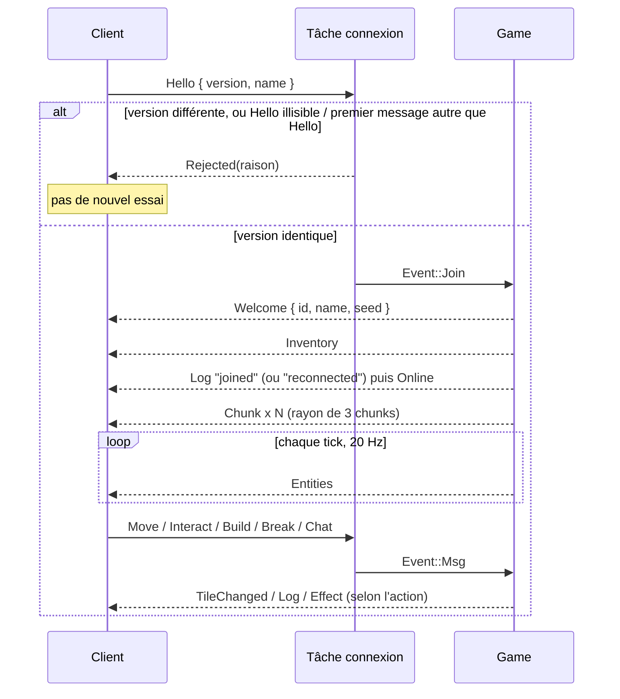

11
| Lignes | Section |
|---|---|
| 18-21 | Framing |
| 22-46 | Messages |
| 47-74 | Séquence de connexion |
| 75-83 | Règles du serveur à l'accueil |
| 84-95 | Keepalive et timeouts |
| 96-99 | Côté client |
| 100-109 | Versionnement |
| 110-112 | Points non vérifiés |
# Protocole client-serveur

> Vérifié le 2026-11-27 depuis `crates/shared/src/protocol.rs`, `crates/shared/src/net.rs`, `crates/server/src/net.rs`, `crates/server/src/game.rs`, `crates/client/src/net.rs`, `crates/client/src/state.rs`.

Un seul socket TCP par client, messages typés dans les deux sens. Les types vivent dans [shared](shared/vue-ensemble.md) ; le serveur et le client ne partagent rien d'autre.

## Framing

`crates/shared/src/net.rs` : chaque message est sérialisé avec **postcard**, puis préfixé de sa longueur sur 4 octets (`LengthDelimitedCodec`, taille max d'une trame `MAX_FRAME` = 1 Mio). `net::split(stream)` donne un `Reader::recv::<T>()` (renvoie `Ok(None)` à la fermeture) et un `Writer::send(&msg)`. `TCP_NODELAY` est activé.

## Messages

Définis dans `crates/shared/src/protocol.rs`.

| `ClientMsg` | Rôle |
|---|---|
| `Hello { version, name }` | premier message obligatoire |
| `Move(Dir)` | avance d'une tuile, ou tourne seulement si bloqué |
| `Interact(Dir)` | caresse un animal, salue un joueur, ou décrit la tuile visée |
| `Build(Dir, Tile)` / `Break(Dir)` | pose la tuile donnée (refusée si son `cost` est vide ; le client envoie `Wall`) / casse la tuile adjacente |
| `Chat(String)` | message public, ou commande si le texte commence par `/` (jamais diffusée, voir [carto serveur](server/carto-architecture.md), section « Commandes de chat ») ; nettoyé côté serveur : caractères cachés supprimés (`strip_hidden`, ZWJ conservé), espaces des bords retirés, 240 caractères max, ignoré s'il n'a aucun caractère visible : ni blanc, ni caché, ni marque combinante (`has_visible_char`) |
| `Ping` | keepalive toutes les 5 s ; ignoré par `Game`, il sert à réarmer le délai de lecture du serveur |
| `Mark` | signale sa position à tous : effet `Marker` sur sa tuile, et un log `System` par joueur en ligne (distance et direction calculées pour lui) ; cooldown serveur de 2 s, ignoré sans réponse dans le cooldown |

| `ServerMsg` | Rôle |
|---|---|
| `Welcome { id, name, seed }` | accepte la connexion (le nom peut être nettoyé, voir « Règles du serveur à l'accueil ») |
| `Chunk(ChunkData)` | contenu complet d'un chunk (`CHUNK_AREA` = 1024 tuiles et biomes) |
| `TileChanged { pos, tile }` | une tuile a changé, envoyé aux joueurs qui détiennent le chunk |
| `Entities(Vec<EntityView>)` | entités proches du joueur, envoyé à chaque tick |
| `Log(LogLine)` | ligne de journal (`System`, `Info`, `Chat`, `Animal`) |
| `Effect { pos, effect }` | effet visuel éphémère |
| `Online(Vec<(String, u8)>)` | joueurs connectés `(nom, couleur)`, à chaque arrivée et départ |
| `Rejected(String)` | refus (versions différentes, handshake invalide `bad handshake, update your client`, ou session remplacée : `name <nom> used by a new connection`) ; le serveur ferme ensuite le socket |
| `Inventory(Vec<(Item, u16)>)` | inventaire complet du joueur, envoyé juste après `Welcome` (y compris session remplacée) et à chaque changement (objet ajouté ; rien si la pile est pleine) |

## Séquence de connexion

Le point clé : `Entities` est le seul message périodique. Les chunks ne sont envoyés qu'à l'entrée dans la zone de vue (voir [server/carto-architecture.md](server/carto-architecture.md), section « Streaming de chunks »).

## Règles du serveur à l'accueil

- `Hello` doit arriver en moins de `HELLO_TIMEOUT` (10 s), sinon la connexion est fermée en silence.
- Premier message illisible (décodage impossible) ou différent de `Hello` : `Rejected("bad handshake, update your client")` puis fermeture. Timeout du `Hello` ou connexion fermée par le client : fermeture sans message.
- Un `Hello` hors du premier message est ignoré.
- Nom : contrôles, U+2028-2029, braille vide, U+FFF9-FFFB et toute la propriété Unicode `Default_Ignorable_Code_Point` supprimés (`is_hidden_char`, `strip_hidden` ; ZWJ conservé ; sélecteurs de variante FE00-FE0F et E0100-E01EF conservés seulement derrière un caractère non blanc, ex. `❤️`) puis espaces des bords retirés, 16 caractères max, `player` si rien de visible (vide, blancs, ZWJ ou marques combinantes seuls) (`clean_name`). Un chat sans caractère visible est rejeté comme un chat vide (`has_visible_char`).
- Nom déjà connecté : la nouvelle connexion **remplace** l'ancienne (plus de suffixe `2`, `3`…). L'ancienne reçoit `Rejected("name <nom> used by a new connection")` puis est fermée ; la nouvelle reprend l'id, la position et l'orientation (les animaux apprivoisés sont liés au nom, ils suivent donc). Le `Leave` tardif de l'ancienne connexion est sans effet : `Game.players` est indexé par `ConnId`.
- Les messages `ClientMsg` d'une connexion non enregistrée dans `Game` sont ignorés.

## Keepalive et timeouts

| Où | Délai | Effet |
|---|---|---|
| Serveur, attente de `Hello` | 10 s (`HELLO_TIMEOUT`) | connexion fermée en silence |
| Serveur, lecture | 15 s sans aucun message (`READ_TIMEOUT`) | fin de session, `Leave` : le joueur passe hors ligne, position gardée |
| Client, envoi | `Ping` toutes les 5 s (`PING_EVERY`) | garde la session vivante côté serveur |
| Client, `connect` | 5 s (`CONNECT_TIMEOUT`) | échec puis nouvel essai |
| Client, silence du serveur | 5 s (`SILENCE`) | `Disconnected`, puis reconnexion (le serveur émet `Entities` à 20 Hz) |

File d'envoi serveur par client : `mpsc::channel(SEND_QUEUE)` = 256 messages. Envoi par `try_send` ; file pleine (client gelé ou trop lent) : le joueur est déconnecté au tick suivant. La fin de la tâche d'écriture ferme aussi la lecture, et inversement.

## Côté client

`crates/client/src/net.rs` : une tâche en boucle de reconnexion (pause de 2 s). `Rejected` est le seul cas sans nouvel essai (y compris `name <nom> used by a new connection`). Une coupure détectée par le silence de 5 s ou le timeout de `connect` repart en reconnexion. À `Welcome`, `GameState` est remis à zéro (le journal est conservé). Détails dans [client/carto-architecture.md](client/carto-architecture.md).

## Versionnement

> [!WARNING]
> Tout changement incompatible de `ClientMsg`, `ServerMsg` ou de leurs types imbriqués incrémente `PROTOCOL_VERSION` (actuellement 5). Postcard n'a pas de champs nommés : l'ordre des variantes et des champs est le format.

- Ajouter une variante de message : à la **fin** de l'enum, puis incrémenter la version.
- Contenu (`Tile`, `Biome`, `Species`, `Effect`, `Item`) : ces enums transitent aussi sur le réseau (`ChunkData`, `Look`, `Effect`, `Inventory`) et dans la sauvegarde. Ajouter les lignes en **fin de table**, jamais en milieu ni en suppression. Voir [guide-ajout-contenu.md](guide-ajout-contenu.md).
- Un client dont la version diffère reçoit `Rejected` : il faut le recompiler.
- Le format de sauvegarde a sa propre version (`SAVE_VERSION`, voir [server/carto-architecture.md](server/carto-architecture.md), section « Sauvegarde »).

## Points non vérifiés

- Pas de test de compatibilité binaire entre versions du protocole (rien trouvé dans le code).
