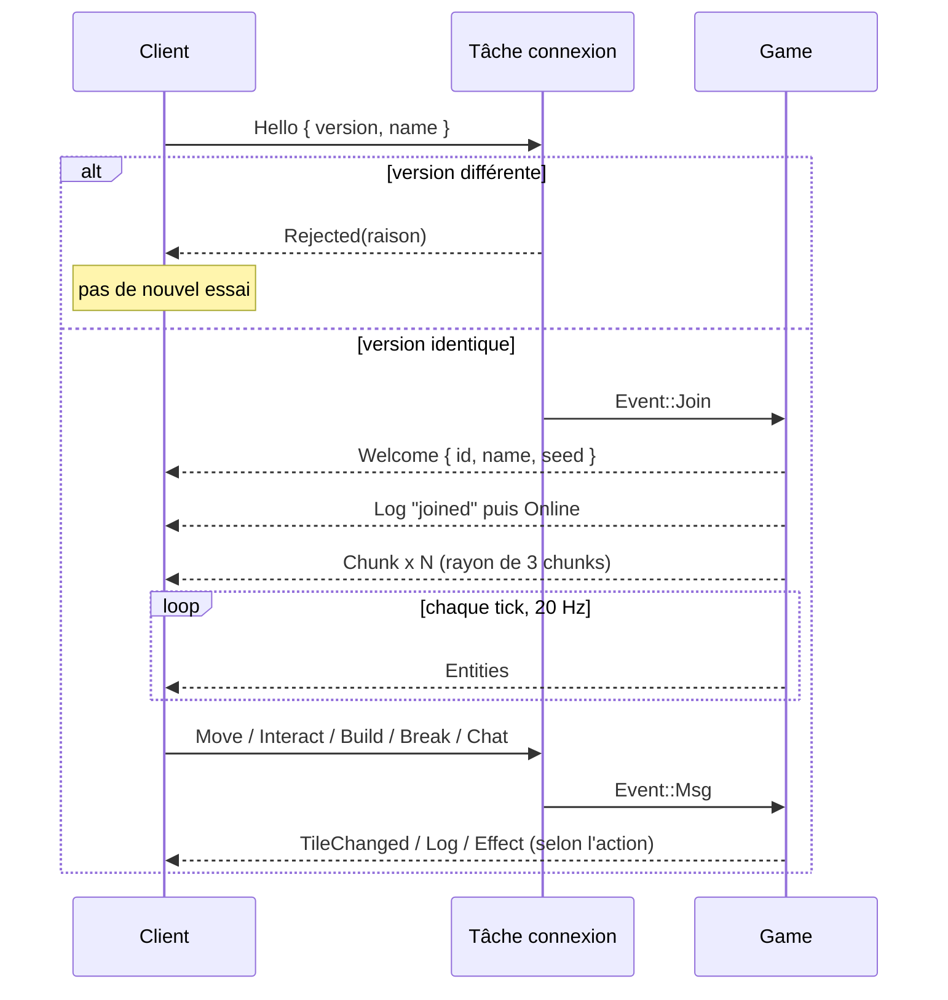

10
| Lignes | Section |
|---|---|
| 17-20 | Framing |
| 21-43 | Messages |
| 44-70 | Séquence de connexion |
| 71-77 | Règles du serveur à l'accueil |
| 78-81 | Côté client |
| 82-91 | Versionnement |
| 92-94 | Points non vérifiés |
# Protocole client-serveur

> Vérifié le 2026-11-20 depuis `crates/shared/src/protocol.rs`, `crates/shared/src/net.rs`, `crates/server/src/net.rs`, `crates/server/src/game.rs`, `crates/client/src/net.rs`, `crates/client/src/state.rs`.

Un seul socket TCP par client, messages typés dans les deux sens. Les types vivent dans [shared](shared/vue-ensemble.md) ; le serveur et le client ne partagent rien d'autre.

## Framing

`crates/shared/src/net.rs` : chaque message est sérialisé avec **postcard**, puis préfixé de sa longueur sur 4 octets (`LengthDelimitedCodec`, taille max d'une trame `MAX_FRAME` = 1 Mio). `net::split(stream)` donne un `Reader::recv::<T>()` (renvoie `Ok(None)` à la fermeture) et un `Writer::send(&msg)`. `TCP_NODELAY` est activé.

## Messages

Définis dans `crates/shared/src/protocol.rs`.

| `ClientMsg` | Rôle |
|---|---|
| `Hello { version, name }` | premier message obligatoire |
| `Move(Dir)` | avance d'une tuile, ou tourne seulement si bloqué |
| `Interact(Dir)` | caresse un animal, salue un joueur, ou décrit la tuile visée |
| `Build(Dir)` / `Break(Dir)` | pose un mur / casse la tuile adjacente |
| `Chat(String)` | message public |

| `ServerMsg` | Rôle |
|---|---|
| `Welcome { id, name, seed }` | accepte la connexion (le nom peut être modifié pour être unique) |
| `Chunk(ChunkData)` | contenu complet d'un chunk (`CHUNK_AREA` = 1024 tuiles et biomes) |
| `TileChanged { pos, tile }` | une tuile a changé, envoyé aux joueurs qui détiennent le chunk |
| `Entities(Vec<EntityView>)` | entités proches du joueur, envoyé à chaque tick |
| `Log(LogLine)` | ligne de journal (`System`, `Info`, `Chat`, `Animal`) |
| `Effect { pos, effect }` | effet visuel éphémère |
| `Online(Vec<(String, u8)>)` | joueurs connectés `(nom, couleur)`, à chaque arrivée et départ |
| `Rejected(String)` | refus (versions différentes) ; le serveur ferme ensuite le socket |

## Séquence de connexion

Le point clé : `Entities` est le seul message périodique. Les chunks ne sont envoyés qu'à l'entrée dans la zone de vue (voir [server/carto-architecture.md](server/carto-architecture.md), section « Streaming de chunks »).

## Règles du serveur à l'accueil

- `Hello` doit arriver en moins de `HELLO_TIMEOUT` (10 s), sinon la connexion est fermée en silence.
- Un `Hello` hors du premier message est ignoré.
- Nom : espaces retirés, caractères de contrôle supprimés, 16 caractères max, `player` si vide ; suffixe `2`, `3`… si déjà pris par un joueur connecté.
- Les messages `ClientMsg` d'une connexion non enregistrée dans `Game` sont ignorés.

## Côté client

`crates/client/src/net.rs` : une tâche en boucle de reconnexion (pause de 2 s). `Rejected` est le seul cas sans nouvel essai. À `Welcome`, `GameState` est remis à zéro (le journal est conservé). Détails dans [client/carto-architecture.md](client/carto-architecture.md).

## Versionnement

> [!WARNING]
> Tout changement incompatible de `ClientMsg`, `ServerMsg` ou de leurs types imbriqués incrémente `PROTOCOL_VERSION` (actuellement 1). Postcard n'a pas de champs nommés : l'ordre des variantes et des champs est le format.

- Ajouter une variante de message : à la **fin** de l'enum, puis incrémenter la version.
- Contenu (`Tile`, `Biome`, `Species`, `Effect`) : ces enums transitent aussi sur le réseau (`ChunkData`, `Look`, `Effect`) et dans la sauvegarde. Ajouter les lignes en **fin de table**, jamais en milieu ni en suppression. Voir [guide-ajout-contenu.md](guide-ajout-contenu.md).
- Un client dont la version diffère reçoit `Rejected` : il faut le recompiler.
- Le format de sauvegarde a sa propre version (`SAVE_VERSION`, voir [server/carto-architecture.md](server/carto-architecture.md), section « Sauvegarde »).

## Points non vérifiés

- Pas de test de compatibilité binaire entre versions du protocole (rien trouvé dans le code).
