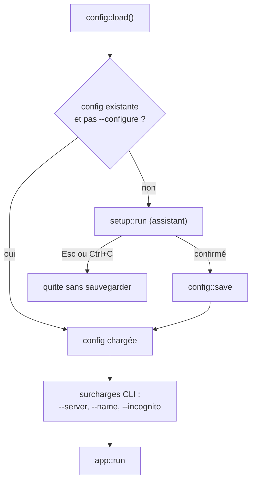
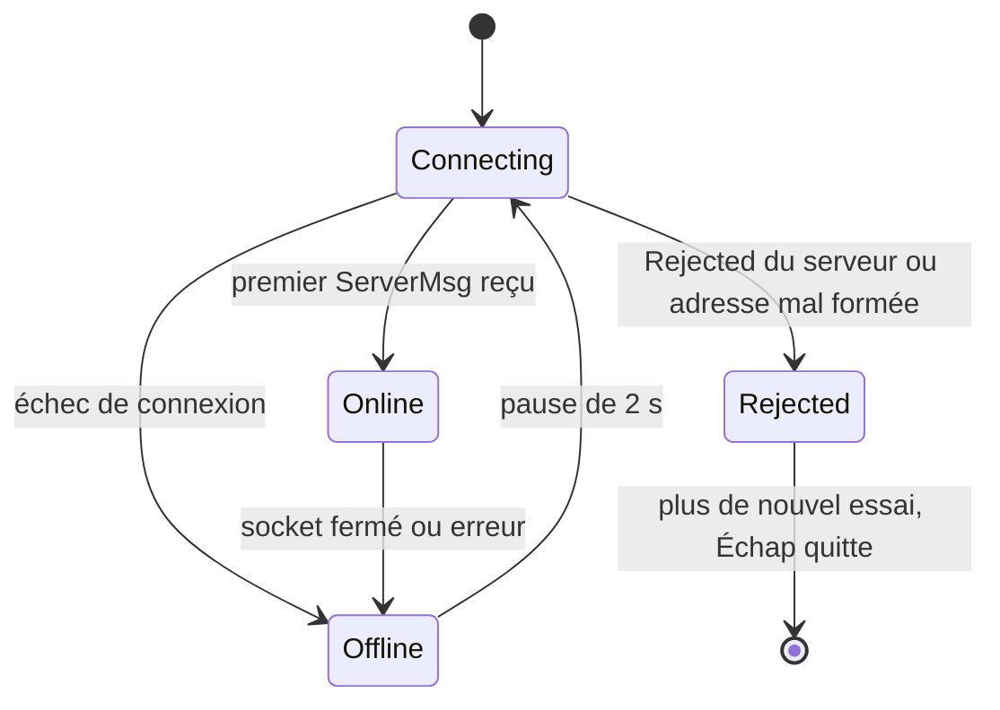
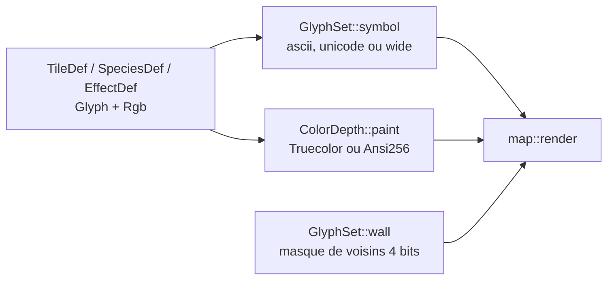
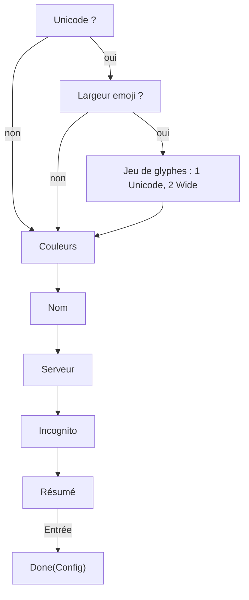

13
| Lignes | Section |
|---|---|
| 18-34 | Modules |
| 35-51 | Démarrage |
| 52-65 | Boucle principale |
| 66-85 | Connexion et reconnexion |
| 86-100 | GameState |
| 101-114 | Layouts |
| 115-133 | Chaîne glyphes et couleurs |
| 134-154 | Assistant de configuration |
| 155-160 | Table BINDINGS |
| 161-165 | Docs liées |
# Client : architecture

> Vérifié le 2026-11-20 depuis `crates/client/src/` (`main.rs`, `app.rs`, `net.rs`, `state.rs`, `input.rs`, `config.rs`, `setup.rs`, `ui/`). Fiche : [vue-ensemble.md](vue-ensemble.md).

## Modules

| Fichier | Rôle |
|---|---|
| `src/main.rs` | arguments `clap`, chargement de la config, assistant ou jeu |
| `src/setup.rs` | assistant de configuration (machine d'états `Wizard`, boucle `run`) |
| `src/config.rs` | `Config` (TOML), `GlyphSet`, `ColorDepth`, chemin du fichier |
| `src/app.rs` | `App`, boucle `tokio::select`, modes `Play` / `Chat`, statut de connexion |
| `src/net.rs` | tâche de connexion avec reconnexion automatique |
| `src/state.rs` | `GameState` : ce que le client sait du monde |
| `src/input.rs` | table `BINDINGS`, `action_for` |
| `src/ui/mod.rs` | `draw` : choisit le layout normal ou incognito |
| `src/ui/game.rs`, `incognito.rs` | les deux layouts |
| `src/ui/map.rs` | rendu de la carte, partagé par les layouts |
| `src/ui/glyphs.rs`, `theme.rs` | choix des symboles et couleurs ; thèmes `NORMAL` et `INCOGNITO` |
| `src/ui/setup.rs` | dessin de l'assistant |

## Démarrage

`main()` charge la config (`config::load`), initialise le terminal (`ratatui::init`), puis :

Les surcharges de la ligne de commande ne durent que la session et ne sont jamais écrites dans le fichier (`incognito` est combiné par OU avec la config).

## Boucle principale

`app::run` crée la tâche réseau (`net::spawn`) et boucle jusqu'à `quit` sur un `tokio::select!` à trois branches :

| Branche | Source | Traitement |
|---|---|---|
| terminal | `crossterm::EventStream` | `App::on_terminal` : touche vers `Action` vers `ClientMsg` |
| réseau | canal `NetEvent` | `App::on_net` : statut, `GameState::apply` |
| frame | `interval` de 33 ms (environ 30 images/s) | `terminal.draw(ui::draw)` |

Aucune simulation côté client : l'écran n'est que le reflet du dernier état reçu. Les actions ne sont envoyées que si `Status::Online`.

Modes de saisie : `Mode::Play` (touches via `BINDINGS`) et `Mode::Chat(String)` (Entrée envoie, Échap annule, 240 caractères max).

## Connexion et reconnexion

`crates/client/src/net.rs` : une tâche en boucle. Chaque `session` ouvre le socket, envoie `Hello`, puis `select` entre lecture serveur et commandes sortantes.

- Les touches envoyées pendant la coupure sont vidées avant de se reconnecter (`while out.try_recv().is_ok()`).
- À `Disconnected`, `GameState.me` et `online` sont remis à vide ; la carte devient vide (`map::render` ne dessine rien sans `me`) sous le popup de statut. À `Welcome`, tout l'état est remplacé sauf le journal.
- Le statut passe à `Online` dès le premier message, `Welcome` inclus.
- L'adresse serveur est normalisée (`config::normalize_server`, port `DEFAULT_PORT` ajouté s'il manque) à la sortie de l'assistant et au démarrage (`--server`, `IDK_SERVER`, fichier). Une adresse mal formée (`connect` en `InvalidInput`) donne `Rejected` ; un hôte inconnu (erreur DNS) reste en retry.

## GameState

`crates/client/src/state.rs`, reconstruit par `apply(ServerMsg)` :

| Champ | Alimenté par |
|---|---|
| `me`, `name`, `seed` | `Welcome` |
| `chunks` (privé) | `Chunk` (ignoré si invalide), `TileChanged` ; purge au-delà de `KEEP_CHUNKS` (4, `crates/shared/src/protocol.rs`) chunks de la position du joueur |
| `entities` | `Entities` (remplacement complet à chaque tick) |
| `online` | `Online` |
| `log` | `Log` et lignes locales ; 200 entrées max (`LOG_SIZE`), horodatées à la réception |
| `effects` | `Effect`, expiration selon `duration_ms` de l'effet |

`KEEP_CHUNKS` est partagé avec le serveur (voir [server/carto-architecture.md](../server/carto-architecture.md), section « Streaming de chunks ») : client et serveur oublient un chunk à la même distance. Lors du dessin, un joueur passe devant un animal sur la même tuile (`entity_at`).

## Layouts

`ui::draw` choisit selon `App.incognito`, basculable à chaud par F2 (action `ToggleIncognito`), sans toucher à la connexion.

| | Normal (`ui/game.rs`) | Incognito (`ui/incognito.rs`) |
|---|---|---|
| Carte | couleurs de la table de contenu, jeu de glyphes de la config | monochrome gris, **toujours ASCII** (`GlyphSet::Ascii`) ; le sol praticable est laissé vide |
| Cadre | panneaux `you`, `online`, `nearby`, `keys`, journal (au plus 9 lignes de haut, bordures comprises, réduit à un quart de la hauteur du terminal avec un minimum de 4 ; sidebar : `you` en priorité, puis `keys` entier ou masqué, puis `online` et `nearby` selon la place restante ; la graine s’affiche en hex court dans le titre de la carte seulement si la carte fait 40 colonnes ou plus) | barre d'onglets (`<biome>.rs`, `world.log`, `Cargo.toml`), gouttière de numéros de ligne = coordonnée y, panneau `OUTPUT` (8 lignes max en-tête compris, au plus un tiers de l'écran) |
| Journal | heure, texte coloré par type | format de logs serveur : `ISO8601 NIVEAU message` (`Animal` = DEBUG, départs et déconnexions = WARN) |
| Barre d'état | popup centrée si non connecté | `NORMAL` / `INSERT` façon vim, `Ln y, Col x`, chat saisi comme ligne de commande `:` |
| Aide des touches | panneau `keys`, généré depuis `BINDINGS` | aucune |

Point clé : le thème `INCOGNITO` (`ui/theme.rs`) est sans couleur de carte (`map_colors: false`), pour que l'écran ressemble à un éditeur à côté d'un journal.

## Chaîne glyphes et couleurs

Les tables de `idk-shared` donnent pour chaque chose un `Glyph { ascii, unicode, wide }` et des `Rgb`. À l'affichage (`ui/map.rs`, `ui/glyphs.rs`) :

- `GlyphSet` : `Ascii`, `Unicode` (défaut), `Wide` (deux cellules par tuile, `tile_width()` = 2).
- `ColorDepth::Ansi256` approche chaque `Rgb` de la palette xterm (cube 6x6x6 ou rampe de gris).
- Les murs (`def.connects`) choisissent un trait de boîte selon leurs voisins identiques (`wall_mask` : 1 nord, 2 est, 4 sud, 8 ouest) ; en `Wide`, une seconde cellule prolonge le trait vers l'est.
- Priorité d'affichage d'une cellule : effet, puis entité, puis tuile. La tuile visée est éclaircie (normal) ou soulignée (incognito).
- Fond : `bg` de la tuile, sinon `bg` du biome, sinon `theme.unknown` ; chunk inconnu = fond `unknown`.

## Assistant de configuration

`crates/client/src/setup.rs` : `Wizard` est une machine d'états pure, alimentée par `on_key`, donc testable sans terminal ; `ui/setup.rs` la dessine (aperçu de carte), `setup::run` la pilote.

- Non à la première question : jeu `Ascii`, les deux questions emoji sont sautées.
- Réponse non à la largeur des emoji : jeu `Unicode`.
- Nom et serveur : saisie libre (24 et 64 caractères max) ; vide = valeur par défaut de la config de départ (celle sauvegardée, ou `Config::default`).
- Retour arrière : à vide dans un champ texte ou hors champ, revient à la question précédente effectivement posée (les étapes sautées ne sont pas dans l'historique).
- Échap ou Ctrl+C : `Outcome::Cancel`, quitte sans sauvegarder.

## Table BINDINGS

`crates/client/src/input.rs` : tableau de `Binding { keys, action, help }`. `action_for` met la lettre en minuscule, traite Ctrl+C comme `Quit`, puis cherche la première ligne qui contient la touche. Le champ `help` génère le panneau `keys` : une ligne sans `help` est une variante d'une ligne affichée. Un test vérifie qu'aucune touche n'est liée deux fois.

Ajouter une touche : une ligne dans `BINDINGS`, une variante dans `Action`, un cas dans `App::act` (`crates/client/src/app.rs`). Les touches sont listées dans le [README](../../../../README.md), section « Contrôles ».

## Docs liées

- [carto-protocole.md](../carto-protocole.md)
- [server/carto-architecture.md](../server/carto-architecture.md)
- [guide-ajout-contenu.md](../guide-ajout-contenu.md)
