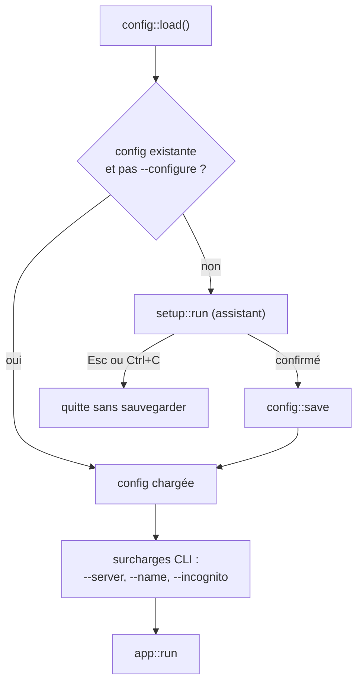
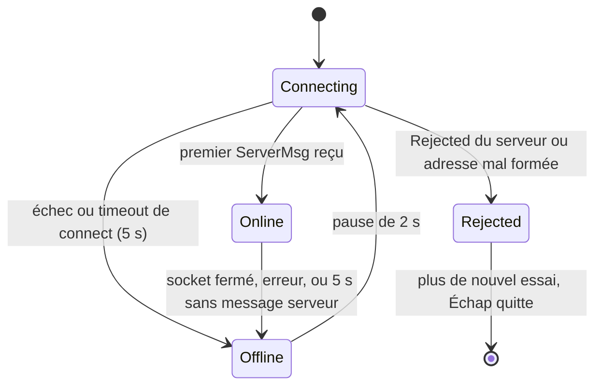
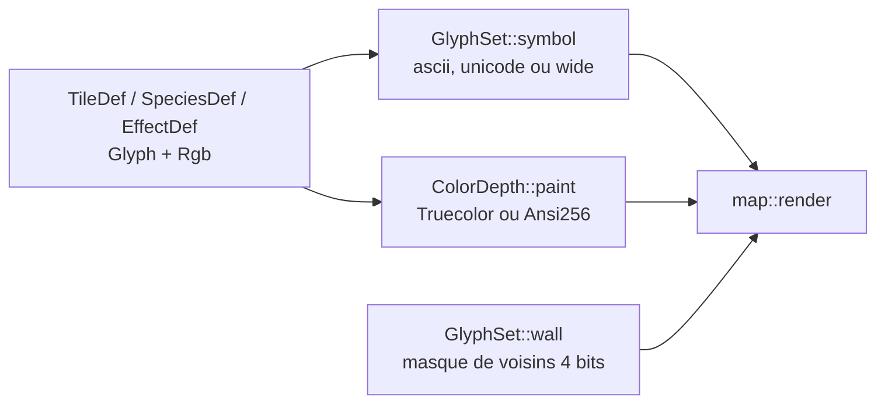
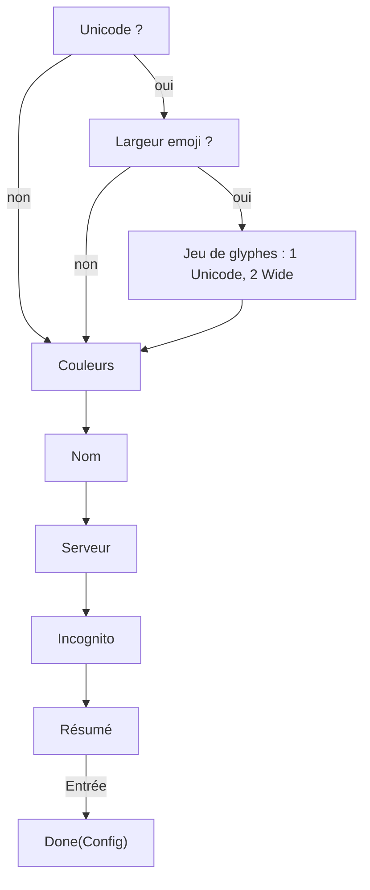

13
| Lignes | Section |
|---|---|
| 18-35 | Modules |
| 36-54 | Démarrage |
| 55-71 | Boucle principale |
| 72-93 | Connexion et reconnexion |
| 94-110 | GameState |
| 111-129 | Layouts |
| 130-151 | Chaîne glyphes et couleurs |
| 152-173 | Assistant de configuration |
| 174-179 | Table BINDINGS |
| 180-184 | Docs liées |
# Client : architecture

> Vérifié le 2026-11-26 depuis `crates/client/src/` (`main.rs`, `app.rs`, `net.rs`, `state.rs`, `input.rs`, `config.rs`, `setup.rs`, `ui/`). Fiche : [vue-ensemble.md](vue-ensemble.md).

## Modules

| Fichier | Rôle |
|---|---|
| `src/main.rs` | arguments `clap`, chargement de la config, assistant ou jeu |
| `src/setup.rs` | assistant de configuration (machine d'états `Wizard`, boucle `run`) |
| `src/config.rs` | `Config` (TOML), `GlyphSet`, `ColorDepth`, chemin du fichier |
| `src/app.rs` | `App`, boucle `tokio::select`, modes `Play` / `Chat` / `Help`, statut de connexion |
| `src/net.rs` | tâche de connexion avec reconnexion automatique |
| `src/state.rs` | `GameState` : ce que le client sait du monde |
| `src/input.rs` | table `BINDINGS`, `action_for`, `push_pasted`, `pop_grapheme` |
| `src/ui/mod.rs` | `draw` : choisit le layout normal ou incognito |
| `src/ui/game.rs`, `incognito.rs` | les deux layouts |
| `src/ui/help.rs` | popup d'aide (F1) dessiné par-dessus le layout normal |
| `src/ui/map.rs` | rendu de la carte, partagé par les layouts |
| `src/ui/glyphs.rs`, `theme.rs` | choix des symboles et couleurs ; thèmes `NORMAL` et `INCOGNITO` |
| `src/ui/setup.rs` | dessin de l'assistant |

## Démarrage

`main()` charge la config (`config::load`), initialise le terminal (`ratatui::init`), puis :

Les surcharges de la ligne de commande ne durent que la session et ne sont jamais écrites dans le fichier (`incognito` est combiné par OU avec la config). Si la sauvegarde de la config échoue (volume en lecture seule), le jeu continue avec la config en mémoire et un avertissement s'affiche sur stderr après la restauration du terminal. Un fichier de config invalide est renommé en `.bak` (message sur stderr) avant de relancer l'assistant. `main()` active aussi le collage bracketed (`EnableBracketedPaste`).

Nom par défaut (`config::default_name`) : `$USER` s'il est non vide, sinon `player-XXXX` (4 chiffres tirés de l'heure et du pid), car l'image docker n'a pas `USER` et un nom fixe ferait s'éjecter les joueurs entre eux. L'assistant écrit ce nom dans le fichier de config : il reste stable d'un lancement à l'autre tant que la sauvegarde réussit.

## Boucle principale

`app::run` crée la tâche réseau (`net::spawn`) et boucle jusqu'à `quit` sur un `tokio::select!` à quatre branches :

| Branche | Source | Traitement |
|---|---|---|
| terminal | `crossterm::EventStream` | `App::on_terminal` : touche vers `Action` vers `ClientMsg` |
| signal | SIGTERM (`docker stop`), SIGHUP (fenêtre fermée) ; Unix seulement | `quit = true` : sortie normale, `main` restaure le terminal. Couvert aussi pendant l'assistant : `setup::run` lit les touches via `EventStream` dans un `tokio::select!` avec le même `terminate_signal` ; le signal vaut annulation (`Ok(None)`), `main` restaure alors le terminal et sort |
| réseau | canal `NetEvent` | `App::on_net` : statut, `GameState::apply` |
| frame | `interval` de 33 ms (environ 30 images/s) | `terminal.draw(ui::draw)` |

Aucune simulation côté client : l'écran n'est que le reflet du dernier état reçu. Les actions ne sont envoyées que si `Status::Online`.

Modes de saisie : `Mode::Play` (touches via `BINDINGS`), `Mode::Help { scroll: u16 }` (écran d'aide, voir ci-dessous) et `Mode::Chat(String)` (Entrée envoie, Échap annule, 240 caractères max ; Ctrl/Alt/Super + touche ignorés sauf Ctrl+C qui quitte ; un collage devient une ligne unique, retours à la ligne remplacés par des espaces, jamais envoyée toute seule ; ↑/↓ parcourent l'historique des messages réellement envoyés pendant la session, `chat_history` (50 max, doublon consécutif ignoré, non persisté) : le 1er ↑ sauvegarde le tampon dans `chat_draft`, ↓ au-delà du dernier le restaure, `Action::Chat` remet `history_pos` à `None`). Esc en jeu (`ConfirmQuit`) : le premier Esc journalise « Press Esc again to quit. », un second Esc dans les 2 s (`QUIT_CONFIRM`) quitte, toute autre touche entre les deux désarme la confirmation (`quit_armed = None`) ; statut `Rejected` : un seul Esc quitte (l'événement `Rejected` écrit « Rejected: <raison> » au journal et vide l'état de jeu comme une déconnexion). Anti-autorepeat : sans protocole clavier kitty, un Esc maintenu arrive en `Press` répétés. `Repeat` et tout Esc reçu moins de 150 ms (`ESC_REPEAT`) après le précédent Esc sont ignorés (en jeu comme en chat, donc le Esc qui ferme le chat n'arme rien) ; ils repoussent l'horodatage (`last_esc`, et `quit_armed` s'il est armé) : une rafale continue ne quitte jamais, le second Esc valide doit venir entre 150 ms et 2 s après le dernier Esc. Ctrl+C quitte tout de suite.

Écran d'aide : F1 (`Action::Help`) en `Mode::Play` ouvre `Mode::Help { scroll: 0 }` ; sans effet en incognito (`act` ignore l'action : aucun popup de jeu dans le faux éditeur, donc `Help` n'existe jamais avec `incognito` actif). En aide : Esc ou F1 referment (retour en `Play`, Esc n'arme pas `quit_armed` ni ne journalise « Press Esc again » ; le filtre d'autorepeat `last_esc` s'applique avant, donc un Esc maintenu ne quitte pas non plus), ↑/↓ défilent d'une ligne, PgUp/PgDn de `HELP_PAGE` (10) lignes (ils ne touchent pas `log_scroll`), toute autre touche est ignorée (F2 compris). Ctrl+C quitte comme en chat (les autres Ctrl/Alt/Super + touche sont ignorés). Borne du défilement : la hauteur visible n'est connue qu'au rendu, `ui::help::draw` écrit donc `App.help_max_scroll` (`Cell<u16>` = lignes de contenu moins hauteur du corps) et `on_terminal_at` y borne `scroll` ; le rendu applique aussi `min` (terminal redimensionné entre deux images). Légende : les tuiles `connects` (mur) montrent le mur isolé (`GlyphSet::wall(0, …)`), comme la carte, pas `def.glyph`.

## Connexion et reconnexion

`crates/client/src/net.rs` : une tâche en boucle. Chaque `session` ouvre le socket, envoie `Hello`, puis `select` entre lecture serveur, commandes sortantes, `Ping` périodique et échéance de silence.

- Keepalive : `ClientMsg::Ping` toutes les 5 s (`PING_EVERY`), sinon le serveur ferme la session après 15 s de silence. Détection d'un serveur gelé ou d'une coupure sans fermeture TCP : si aucun message serveur n'arrive pendant 5 s (`SILENCE`, le serveur émet `Entities` à 20 Hz), la session échoue (`Disconnected: no data from server for 5 s`) et la reconnexion démarre. L'échéance n'est repoussée que par les messages du serveur, pas par les touches du joueur. `connect` a un timeout de 5 s (`CONNECT_TIMEOUT`).
- Reconnexion sous le même nom : le serveur remplace l'éventuelle session fantôme et rend la position, l'orientation et les animaux apprivoisés. Si c'est cette session-ci qui est remplacée (autre client avec le même nom), elle reçoit `Rejected("name <nom> used by a new connection")` : statut `Rejected`, pas de nouvel essai, donc pas de vol de session en boucle.
- Les touches envoyées pendant la coupure sont vidées avant de se reconnecter (`while out.try_recv().is_ok()`).
- À `Disconnected`, `GameState::disconnect` garde les chunks et la dernière position connue (conservée aux `Disconnected` suivants, quand `me` est déjà vide : le dernier `my_pos()` connu n'est jamais écrasé par `None`), et vide `me`, `entities`, `online` et les effets (la ligne « Disconnected: … » n'est journalisée que si le statut était `Online`) ; `map::render` dessine alors la carte grisée (couleurs assombries, `DIM`, sans entités ni case visée) sous le popup de statut. Le panneau `you` affiche alors « offline » et la dernière position (`pos`) au lieu de « not in the world yet » (réservé à l'état avant le 1er `Welcome`). L'éditeur incognito (F2) se centre aussi sur `map_center()` : texte et gutter restent visibles hors ligne. Le chat ne s'ouvre pas hors ligne : le journal local reçoit « Not connected. » ; si le chat était déjà ouvert à la coupure, Entrée le laisse ouvert avec son texte (rien n'est envoyé) et journalise la même ligne. Une fois une session établie (`GameState::is_offline`), `NetEvent::Connecting` (une fois par tentative) n'écrase plus `Status::Offline` : le popup reste stable sur « offline <raison> / retrying » au lieu d'alterner avec « connecting » ; avant la 1re session, `Connecting` s'affiche normalement. À `Welcome`, tout l'état est remplacé sauf le journal.
- Le statut passe à `Online` dès le premier message, `Welcome` inclus.
- L'adresse serveur est normalisée (`config::normalize_server`, port `DEFAULT_PORT` ajouté s'il manque) à la sortie de l'assistant et au démarrage (`--server`, `IDK_SERVER`, fichier). Une adresse mal formée (`connect` en `InvalidInput`) donne `Rejected` ; un hôte inconnu (erreur DNS) reste en retry.

## GameState

`crates/client/src/state.rs`, reconstruit par `apply(ServerMsg)` :

| Champ | Alimenté par |
|---|---|
| `me`, `name`, `seed` | `Welcome` |
| `chunks` (privé) | `Chunk` (ignoré si invalide), `TileChanged` ; purge au-delà de `KEEP_CHUNKS` (4, `crates/shared/src/protocol.rs`) chunks de la position du joueur |
| `entities` | `Entities` (remplacement complet à chaque tick) |
| `online` | `Online` |
| `inventory` | `Inventory` (remplacement complet), vidé au `Welcome` ; pas encore affiché |
| `log` | `Log` et lignes locales ; 200 entrées max (`LOG_SIZE`), horodatées à la réception |
| `log_scroll` | PgUp / PgDn / End : nombre d'entrées cachées sous la vue (0 = en bas), conservé au `Welcome` comme `log` |
| `effects` | `Effect`, expiration selon `duration_ms` de l'effet |

`KEEP_CHUNKS` est partagé avec le serveur (voir [server/carto-architecture.md](../server/carto-architecture.md), section « Streaming de chunks ») : client et serveur oublient un chunk à la même distance. `push_log` incrémente `log_scroll` quand il est > 0 (la vue ne bouge pas à l'arrivée d'un message) puis le borne à `log.len() - 1` ; quand le journal est plein, l'entrée retirée est la plus ancienne, donc jamais sous la vue : rien d'autre à ajuster. `visible_log(rows)` renvoie les `rows` entrées qui finissent `log_scroll` entrées avant la fin (les deux `draw_log` l'utilisent). Le défilement se fait par entrée, pas par ligne repliée. Lors du dessin, un joueur passe devant un animal sur la même tuile (`entity_at`).

## Layouts

`ui::draw` choisit selon `App.incognito`, basculable à chaud par F2 (action `ToggleIncognito`), sans toucher à la connexion. En `Mode::Help`, `ui::draw` dessine d'abord `game::draw` puis `help::draw` par-dessus (`Clear`). F2 reste actif en saisie de chat (`App::on_terminal` le traite avant le `match` sur le mode, le texte saisi est conservé).

| | Normal (`ui/game.rs`) | Incognito (`ui/incognito.rs`) |
|---|---|---|
| Carte | couleurs de la table de contenu, jeu de glyphes de la config | monochrome gris, **toujours ASCII** (`GlyphSet::Ascii`) ; le sol praticable est laissé vide |
| Cadre | panneaux `you`, `online`, `nearby`, `keys`, journal (au plus 9 lignes de haut, bordures comprises, réduit à un quart de la hauteur du terminal avec un minimum de 4 ; sidebar masquée si le terminal fait moins de 52 colonnes (20 de carte + 32), la carte prend alors toute la largeur ; sidebar : `you` en priorité, puis `keys` entier ou masqué, puis `online` et `nearby` selon la place restante ; la graine s’affiche en hex court dans le titre de la carte seulement si la carte fait 40 colonnes ou plus et si un `Welcome` a été reçu, donc jamais avant la 1re connexion) | barre d'onglets (`<biome>.rs` avec les espaces du nom remplacés par `_`, ex. `deep_lake.rs`, ou `main.rs` tant que le biome est inconnu ; puis `world.log`, `Cargo.toml`), gouttière de numéros de ligne = coordonnée y, panneau `OUTPUT` (8 lignes max en-tête compris, au plus un tiers de l'écran) |
| Journal | heure locale `HH:MM:SS`, texte coloré par type, retour à la ligne des longs messages, saisie du chat défilée (fin du texte visible) | format de logs serveur : `ISO8601 NIVEAU message`, retour à la ligne des longs messages et défilement pour garder le bas visible (`game::render_tail`, partagé avec le layout normal), ISO8601 en heure locale avec fuseau (`Z` ou `±HH:MM`) ; `Animal` = DEBUG, départs (« left the world. ») et déconnexions (« Disconnected… ») = WARN, le reste INFO ; chat préfixé `[chat] <nom>` |
| Barre d'état | popup centrée si non connecté | `NORMAL` / `INSERT` façon vim, `Ln y, Col x`, chat saisi comme ligne de commande `:`, `N users` et heure locale `HH:MM` à droite ; l'état de connexion s'affiche dans la barre (pas de popup) |
| Indicateur de défilement | titre du bloc `log` suffixé de ` ↓N` (` vN` en ASCII) quand `log_scroll` = N > 0 | en-tête ` OUTPUT (N more)` |
| Aide des touches | panneau `keys`, généré depuis `BINDINGS` ; F1 ouvre l'écran d'aide complet (`ui/help.rs`) | aucune |

Journal : `game::render_tail` pré-replie par graphème (`prewrap_long_words`) les lignes contenant un mot plus large que la zone, car le `Wrap` de ratatui renverrait ce mot entier à la ligne suivante. Panneau `online` : si les noms dépassent la hauteur utile (bordures retirées), les derniers sont remplacés par une ligne grisée `+K more`.

Fuseau : `state::utc_offset` (via `chrono`, lu une fois ; en docker, `/etc/localtime` est monté par `docker-compose.yml`). Le jeu de glyphes de la config ne change que les symboles du chrome (voir « Chaîne glyphes et couleurs »).

Point clé : le thème `INCOGNITO` (`ui/theme.rs`) est sans couleur de carte (`map_colors: false`), pour que l'écran ressemble à un éditeur à côté d'un journal.

## Chaîne glyphes et couleurs

Les tables de `idk-shared` donnent pour chaque chose un `Glyph { ascii, unicode, wide }` et des `Rgb`. À l'affichage (`ui/map.rs`, `ui/glyphs.rs`) :

- `GlyphSet` : `Ascii`, `Unicode` (défaut), `Wide` (deux cellules par tuile, `tile_width()` = 2).
- `ColorDepth::Ansi256` approche chaque `Rgb` de la palette xterm (cube 6x6x6 ou rampe de gris).
- Les murs (`def.connects`) choisissent un trait de boîte selon leurs voisins identiques (`wall_mask` : 1 nord, 2 est, 4 sud, 8 ouest) ; en `Wide`, une seconde cellule prolonge le trait vers l'est.
- Priorité d'affichage d'une cellule : effet, puis entité, puis tuile. La tuile visée est éclaircie (normal) ou soulignée (incognito).
- Écran d'aide (`ui/help.rs`, `draw(f, app)`) : popup centré, marges de 2 (`Rect::inner` renvoie un rectangle vide si le terminal est trop petit, pas de panique), bordure `ui::bordered`, titre ` help — esc to close ` (`-` en ASCII). Contenu généré par `lines` : section `keys` (une ligne par `Binding` de `BINDINGS`, toutes les touches y compris les variantes sans `help`, via `key_name` ; libellé via `action_label`, `→` remplacé par `->` en ASCII ; ligne `ctrl-c` ajoutée à la main car absente de `BINDINGS`), section `tiles` (`Tile::ALL`), section `animals` (`Species::ALL` puis `PLAYER_GLYPH`) : glyphe du `GlyphSet` courant en couleur `fg`, colonne de 3 cellules, puis le `name`.
- Chrome en jeu de glyphes `Ascii` (`ui::bordered`, `ui::pick`) : bordures `+-|`, spinner `| / - \`, curseur de saisie `_`, `...`, `<3`, séparateurs `-`/`|`, `arrows` à la place des flèches dans le panneau `keys`, `up`/`down`/`left`/`right` et `->` dans l'écran d'aide ; sinon bordures arrondies, spinner braille, `█`, `…`, `♥`, `·`.
- Hors ligne : la carte est dessinée avec couleurs divisées par 2 et `DIM` (`map::render`).
- Fond : `bg` de la tuile, sinon `bg` du biome, sinon `theme.unknown` ; chunk inconnu = fond `unknown`.

## Assistant de configuration

`crates/client/src/setup.rs` : `Wizard` est une machine d'états pure, alimentée par `on_key`, donc testable sans terminal ; `ui/setup.rs` la dessine (aperçu de carte), `setup::run` (async) la pilote.

- Non à la première question : jeu `Ascii`, les deux questions emoji sont sautées.
- Réponse non à la largeur des emoji : jeu `Unicode`.
- Nom et serveur : saisie libre (`MAX_NAME` = 16, partagé avec le serveur, et 64 caractères max ; collage accepté sur une ligne) ; vide = valeur par défaut de la config de départ (celle sauvegardée, ou `Config::default`). Une adresse serveur contenant un espace est refusée (`Wizard.error`, affiché sous le champ, effacé à la touche suivante).
- Terminal trop bas : `ui/setup.rs` retire d'abord les parties décoratives (aperçus de carte, échantillon de cadre, lignes vides), puis coupe le haut ; la question et la ligne de touches restent visibles.
- Retour arrière : à vide dans un champ texte ou hors champ, revient à la question précédente effectivement posée (les étapes sautées ne sont pas dans l'historique).
- Échap ou Ctrl+C : `Outcome::Cancel`, quitte sans sauvegarder.

## Table BINDINGS

`crates/client/src/input.rs` : tableau de `Binding { keys, action, help }`. `action_for` met la lettre en minuscule, traite Ctrl+C comme `Quit`, puis cherche la première ligne qui contient la touche. Le champ `help` génère le panneau `keys` : une ligne sans `help` est une variante d'une ligne affichée. Un test vérifie qu'aucune touche n'est liée deux fois. La saisie de texte (chat, assistant) retire au Backspace un graphème entier (`pop_grapheme`), et `ui::tail_fit` mesure la largeur par graphème (comme ratatui) : `❤️` = 2 colonnes, pas `❤` + U+FE0F. Les plafonds (`MAX_CHAT`, `max`) restent comptés en `chars()`, comme côté serveur.

PgUp / PgDn / End (`LogUp`, `LogDown`, `LogEnd`) défilent le journal de `LOG_PAGE` (5) entrées, ou reviennent en bas ; actifs en `Mode::Play` seulement (en chat, ignorés ; en `Mode::Help` ils défilent l'aide). PgDn et End sont des variantes sans `help`. Ajouter une touche : une ligne dans `BINDINGS`, une variante dans `Action`, un cas dans `App::act` (`crates/client/src/app.rs`). Exception : `ConfirmQuit` (Esc) est traité dans `on_terminal_at` avant `act` (son bras dans `act` ne sert qu'à l'exhaustivité du `match`). Les touches sont listées dans le [README](../../../../README.md), section « Contrôles ».

## Docs liées

- [carto-protocole.md](../carto-protocole.md)
- [server/carto-architecture.md](../server/carto-architecture.md)
- [guide-ajout-contenu.md](../guide-ajout-contenu.md)
