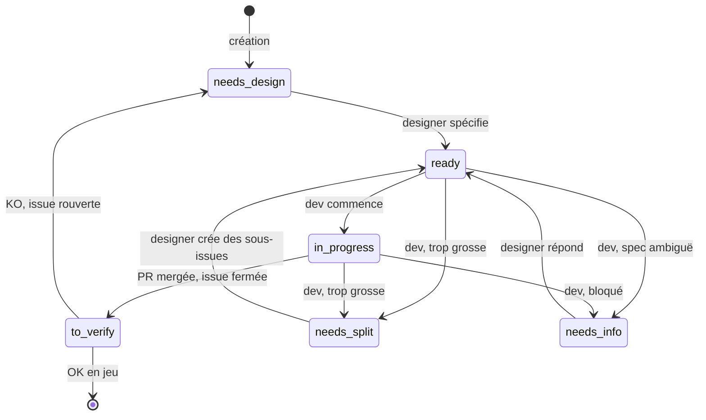

# Guide : workflow IA designer / développeur

Deux tâches planifiées travaillent sur le dépôt sans jamais tourner en même temps :

| Rôle | Heure | Fait |
|---|---|---|
| Designer | 2h | crée les issues, vérifie les bugs, spécifie les features, scinde les tâches trop grandes |
| Développeur | 5h | résout les issues, développe les features, demande la scission quand c'est trop gros |

Ils ne peuvent pas se parler : chacun laisse un message que l'autre lit à son prochain passage. **Les labels portent l'état, les commentaires portent le contenu.** Un aller-retour coûte 24 h (question du dev à 5h, réponse du designer à 2h le lendemain, reprise à 5h). Le dev ne doit donc jamais attendre une réponse : il passe à l'issue suivante.

## Règles communes

- Les deux agents utilisent le même compte GitHub. Première ligne de chaque commentaire : `**[designer]**` ou `**[dev]**`, suivie du statut posé (ex. `**[dev]** needs-split`).
- Une issue ouverte porte au plus un label `status:*`. Un agent qui change l'état retire l'ancien label.
- `needs-human` : les deux agents ignorent l'issue. Posé par un agent quand la décision dépasse le cadre autonome, retiré par l'humain.
- Labels définis dans `.github/labels.yml`, synchronisés par le workflow `Labels` (push sur `main` ou lancement manuel). Pour en ajouter : éditer ce fichier.

## Labels

| Famille | Labels | Posé par |
|---|---|---|
| Type (un seul) | `bug`, `enhancement`, `documentation`, `chore`, `refactor`, `test` (correspond au préfixe de branche et de commit : fix, feat, docs, chore, refactor, test) | créateur de l'issue |
| `epic` (en plus du type) | regroupe des sous-issues, jamais développée | designer |
| `status:*` | `needs-design`, `ready`, `in-progress`, `needs-info`, `needs-split`, `to-verify` | voir le diagramme |
| `prio:*` | `high`, `normal`, `low` (absent = normal) | designer |
| `size:*` | `s`, `m`, `l` ; `size:l` interdit en `status:ready` | designer |
| `area:*` | `shared`, `server`, `client`, `infra` (plusieurs possibles) | designer |

## États



Les identifiants du diagramme sont les labels `status:*` avec `_` à la place de `-`.

## Passage du designer (2h), dans cet ordre

1. Ignorer `needs-human`.
2. `status:to-verify` (issues fermées) : vérifier en jeu (client dans tmux). OK : retirer le label. KO : rouvrir, commentaire `[designer]` avec le constat, `status:needs-design`.
3. `status:needs-split` : lire le découpage proposé, créer les sous-issues (fonction sous-issues de GitHub) en `status:ready`, `size:s` ou `m`. Le parent devient `epic`, perd son `status:*` et se ferme avec ses enfants.
4. `status:needs-info` : répondre en commentaire, corriger le corps de l'issue si la spec était fausse, repasser en `status:ready` (ou `needs-human`).
5. `status:needs-design` : écrire le corps complet (gabarit `.github/ISSUE_TEMPLATE/task.md`), poser type, `area:*`, `prio:*`, `size:*`, puis `status:ready`. Un bug se reproduit d'abord ; non reproductible : fermer `not_planned` avec explication. `size:l` : scinder avant de passer en `ready`.
6. Chercher du nouveau (jouer, relire le code, parcourir les issues `epic`) et créer des issues en `status:needs-design`. Pas de nouvelle issue s'il y a déjà 10 issues `status:ready`.

## Passage du développeur (5h), dans cet ordre

1. Reprendre l'issue `status:in-progress` s'il y en a une (branche existante, dernier commentaire `[dev]`). Une seule à la fois.
2. Sinon prendre une issue `status:ready` : `prio:high` avant `normal` avant `low`, puis le numéro le plus bas. `epic`, `needs-human` et `size:l` exclus.
3. Poser `status:in-progress`, travailler selon CLAUDE.md (branche `<type>/<n>-<slug>`, PR `Closes #N`).
4. Trop gros (plus de ce qui tient dans une session, ou plusieurs crates non prévues) : ne pas commencer à moitié. Commentaire `[dev]` avec la raison et le découpage proposé, `status:needs-split`, issue suivante. Si un travail est déjà engagé, le pousser sur sa branche avant.
5. Spec ambiguë, contradictoire ou bloquée : commentaire `[dev]` avec les questions précises, `status:needs-info`, issue suivante. Ne pas deviner.
6. Fin : PR mergée (vérifications vertes), puis sur l'issue fermée remplacer `status:in-progress` par `status:to-verify`. La section « À vérifier » de la PR dit quoi regarder.
7. Bug trouvé hors scope : créer une issue `bug` en `status:needs-design`, ne pas le corriger dans la PR en cours.

## Forme des commentaires

```md
**[dev]** needs-split
Raison : touche protocole, serveur et client, et la migration de sauvegarde.
Découpage proposé :
1. shared : nouveaux messages (size:s)
2. server : logique et sauvegarde (size:m)
3. client : affichage (size:m)
```
