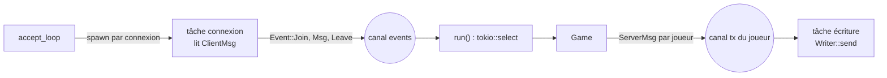
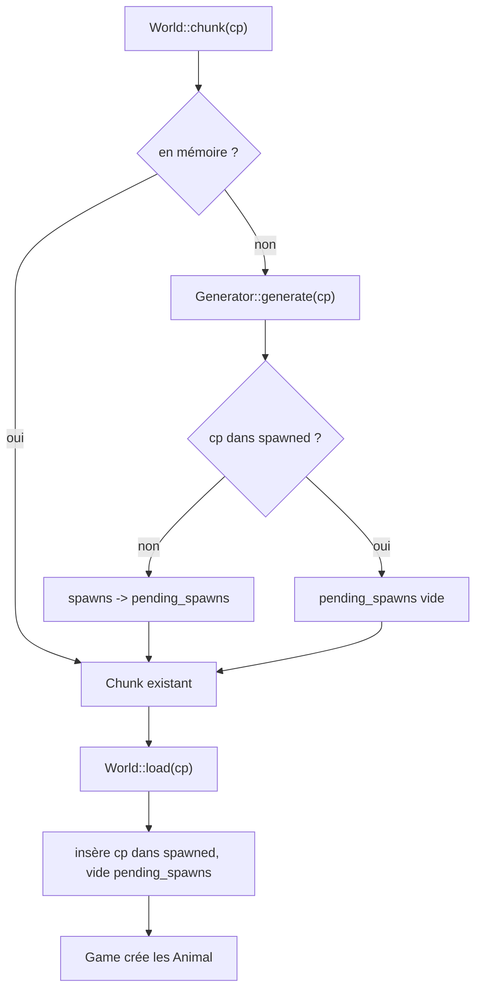

15
| Lignes | Section |
|---|---|
| 20-34 | Modules |
| 35-57 | Boucle de jeu |
| 58-69 | — Tick (20 Hz) |
| 70-81 | — Actions des joueurs |
| 82-94 | — Commandes de chat |
| 95-103 | — Animaux et index de tuiles |
| 104-118 | — Sessions et déconnexions |
| 119-145 | Monde par chunks |
| 146-152 | — Streaming de chunks |
| 153-169 | IA des animaux (paramétrique) |
| 170-199 | Sauvegarde |
| 200-204 | Docs liées |
# Serveur : architecture

> Vérifié le 2026-11-27 depuis `crates/server/src/` (`lib.rs`, `main.rs`, `net.rs`, `game.rs`, `ai.rs`, `save.rs`, `rng.rs`, `world/`). Fiche : [vue-ensemble.md](vue-ensemble.md).

## Modules

| Fichier | Rôle |
|---|---|
| `src/main.rs` | arguments `clap`, journalisation, `TcpListener`, signaux d'arrêt (ctrl-c, SIGTERM) |
| `src/lib.rs` | `run()` : boucle principale, chargement, autosauvegarde |
| `src/net.rs` | `accept_loop`, une tâche par connexion, pont vers `Game` par canaux |
| `src/game.rs` | `Game` : joueurs, animaux, actions, tick, envoi des messages |
| `src/commands.rs` | commandes de chat (`/help`, `/who`, `/me`, `/msg`), table `COMMANDS` |
| `src/ai.rs` | comportement des animaux, caresses et apprivoisement |
| `src/world/mod.rs` | `World` : chunks en mémoire, apparitions, persistance |
| `src/world/generator.rs`, `noise.rs` | génération procédurale (bruit de valeur fractal) |
| `src/save.rs` | `SaveData`, lecture et écriture de `world.bin` |
| `src/rng.rs` | PRNG et hachage déterministes (SplitMix64), sans dépendance externe |

## Boucle de jeu

Une seule tâche possède `Game` : pas de verrou, tout changement passe par `Game::event` ou `Game::tick`. Les tâches réseau n'y touchent que par canaux `mpsc` : `events` non borné (réseau vers jeu), file d'envoi par joueur bornée à `SEND_QUEUE` = 256 messages (jeu vers réseau).

`run()` (`crates/server/src/lib.rs`) attend dans un `tokio::select!` :

| Source | Action |
|---|---|
| `tick` (50 ms) | `game.tick()` ; `MissedTickBehavior::Skip` |
| canal `events` | `game.event()` |
| `autosave` (60 s) | `to_save()` dans la boucle, écriture dans `spawn_blocking` (voir « Sauvegarde ») |
| `shutdown` | sort de la boucle, attend l'écriture en cours, sauvegarde finale synchrone |

### Tick (20 Hz)

`Game::tick` (`TICK` = 50 ms) enchaîne, dans cet ordre :

1. **Mouvements** : exécute le `pending_move` des joueurs dont `next_move` est échu.
2. **IA** : `ai::step`.
3. **Streaming de chunks** : `stream_chunks` pour chaque joueur.
4. **Entités** : `send_entities` envoie à chaque joueur les entités à moins de `VIEW_TILES` (96 tuiles). Le filtre par distance passe avant le clonage : seules les entités visibles sont copiées.
5. **File pleine** : un joueur dont la file d'envoi a débordé pendant le tick est déconnecté (`leave`), voir « Sessions et déconnexions ».

Un `Move` reçu hors cooldown (`MOVE_COOLDOWN` = 90 ms) s'exécute tout de suite dans `handle`. Sinon, il est mémorisé en `pending_move` (un seul, le dernier) pour le prochain tick.

### Actions des joueurs

Dans `Game::handle` : `Interact`, `Build`, `Break` visent la tuile adjacente dans la direction donnée. `Build` pose `Tile::BUILT` (`Wall`) sur une tuile praticable, libre de joueur et d'animal. `Break` utilise `breaks_into` de la définition de la tuile ; si la définition a un `drops`, `add_item` ajoute 1 objet à `Player.inventory` et le journal dit « You break the tree and get 1 wood. ». Pile pleine (`MAX_STACK` = 999) : objet perdu, journal « Your bag is full of wood. ». `set_tile` notifie par `TileChanged` les joueurs qui détiennent le chunk, plus un effet `Dust`.

Avant `Interact`, `Build` ou `Break`, un `pending_move` éventuel est appliqué immédiatement (`try_move`, cooldown ignoré pour ce move, `next_move` remis à jour) : l'action part de la position que le client croit avoir, l'ordre d'envoi est respecté. `Interact` cherche d'abord un joueur sur la tuile visée (salut), puis un animal (caresse) : un animal peut partager la tuile d'un joueur.

`Chat` : caractères cachés supprimés (`is_hidden_char`, ZWJ conservé), `trim`, 240 caractères max (`MAX_CHAT`), message ignoré s'il n'a aucun caractère visible (`has_visible_char` : vide, blancs ou ZWJ seuls) ; diffusé à tous en `Log(Chat)`, sauf s'il commence par `/` (voir « Commandes de chat »).

**Inventaire** : `Player.inventory` est un `Inventory` (`Vec<(Item, u16)>`, une pile par objet, ordre d'obtention). Il suit le joueur dans `offline` (`leave` le sauve, `join` le restaure) et dans le remplacement de session. Envoyé au client par `send_inventory` (`ServerMsg::Inventory`) au `Welcome` et à chaque changement.

Les animaux ne bloquent jamais un joueur (commentaire de `try_move`), mais un joueur bloque les animaux.

### Commandes de chat

Un message de chat nettoyé qui commence par `/` est une commande, jamais diffusé tel quel : `handle` appelle `commands::run(game, conn, ligne_sans_slash)`. Le nom (1er mot) est insensible à la casse ; `/` seul vaut `/help`. Les réponses passent par les `LogKind` existants (`tell`, `broadcast_log`), sans changement de protocole ni de client.

| Commande | Effet |
|---|---|
| `/help` | une ligne `Info` par entrée de `COMMANDS` : `/<usage> — <help>` |
| `/who` | une ligne `Info` par joueur en ligne, triée par nom : distance (`Pos::dist`) et secteur (`cardinal`, 8 directions, `here` sous 2 tuiles) |
| `/me <action>` | `Info` à tous : `* alice <action>` |
| `/msg <nom> <texte>` | `Chat { from: "alice -> bob" }` à l'expéditeur et au destinataire (une copie si message à soi-même) ; le destinataire est le plus long nom en ligne suivi d'un espace, casse ASCII ignorée (les noms peuvent en contenir) |

Commande inconnue : `Unknown command /x, try /help.` ; arguments manquants : `Usage: <usage>`. Ajouter une commande : une entrée dans `COMMANDS` (`name`, `usage`, `help`, `run`) et sa fonction dans `src/commands.rs`.

### Animaux et index de tuiles

`Game.animals` (`HashMap<EntityId, Animal>`) est accompagné de `animal_index` (`HashMap<Pos, EntityId>`) : `animal_at(pos)` est O(1) (il servait de scan linéaire, appelé par `ai::free` jusqu'à 3 fois par pas, `Build`, `Interact`). Les deux champs sont privés à `game.rs` et `Animal.pos` aussi (lecture par `Animal::pos()`, liste par `Game::animals()`, modification des autres champs par `Game::animal_mut`). Seuls points de mutation :

- `Game::insert_animal(espèce, pos, maître, now)` : crée l'animal (spawn de chunk, chargement de save). Un animal par tuile : si la tuile est déjà prise, rien n'est créé (`None`) ; le générateur et `ai::free` l'évitent, mais une vieille save ou un animal arrivé dans un chunk pas encore peuplé peuvent le provoquer (l'animal en trop est ignoré).
- `Game::move_animal(id, pos)` : pas, sidestep, téléportation (`ai::try_step`, `ai::teleport_near`). L'appelant a vérifié que la tuile est libre.

Aucun code ne retire d'animal aujourd'hui ; en ajouter un (mort, despawn) doit retirer aussi l'entrée de `animal_index`. En test, `Game::assert_animal_index` compare l'index à un recalcul complet.

### Sessions et déconnexions

`Game.players` est indexé par `ConnId` (unique par connexion TCP). La tâche connexion (`crates/server/src/net.rs`) :

- ferme la session après `READ_TIMEOUT` = 15 s sans message du client (le client envoie un `Ping` toutes les 5 s) ; une coupure sans fermeture TCP (wifi, half-open) n'immobilise donc plus une session fantôme pendant ~15 min ;
- arrête la lecture quand la tâche d'écriture se termine (écriture en échec, ou `Game` qui lâche le `tx`), et abandonne l'écriture à la fin de la lecture ;
- envoie `Event::Leave(conn)` à la fin.

Côté `Game` :

- Envoi par `Player::send` (`try_send`). File pleine : drapeau `overflow`, déconnexion au tick suivant. File fermée : rien, le `Leave` de la tâche réseau arrive de lui-même.
- `join` avec un nom déjà connecté **remplace** la session : l'ancien joueur est retiré de `players` (son `tx` est lâché, ce qui ferme sa connexion), il reçoit `Rejected("name <nom> used by a new connection")` en dernier message, et la nouvelle connexion reprend `id`, position et orientation (journal système « <nom> reconnected. » au lieu de « joined the world. »). Pas de passage par `offline`. Un nom qui ne diffère d'un joueur en ligne que par la casse ASCII (`Bob` vs `bob`) est refusé : la nouvelle connexion reçoit `Rejected("name <autre> is already online")` et n'est pas insérée. Les animaux apprivoisés sont liés au nom : rien à migrer.
- Le `Leave` tardif de l'ancienne `ConnId` ne trouve plus de joueur : sans effet, il n'écrase ni le nouveau joueur ni `offline`.
- Nom nettoyé par `clean_name` (shared) (contrôles et caractères de format Unicode invisibles filtrés via `is_hidden_char`, `trim`, 16 caractères) ; plus de suffixe numérique.

## Monde par chunks

`World` (`crates/server/src/world/mod.rs`) génère les chunks à la demande et les garde en mémoire (aucune éviction : aucun `remove` ni `retain` sur `chunks` dans le code).

- **Génération** (`generator.rs`) : déterministe pour une graine donnée. L'altitude vient de `fbm(seed, x, y, 160.0, 5)`, la température et l'humidité de deux autres champs de bruit ; `Biome::select(altitude, température, humidité)` choisit le biome parmi la table `BIOMES` (bande d'altitude, puis climat le plus proche). La tuile est tirée dans la palette pondérée du biome, par hachage de la position.
- **Apparitions** : à la génération, on tire les animaux selon `spawns` du biome central du chunk (moyenne par espèce, partie entière plus tirage de la partie fractionnaire). Ils attendent dans `pending_spawns`.
- **`load(cp)`** : renvoie les animaux une seule fois (première insertion dans `spawned`). Lire une tuile avant n'efface pas les animaux (test `reading_a_tile_does_not_lose_the_chunk_animals`).
- **`spawned`** : ensemble des chunks dont les animaux ont déjà été créés. Il survit aux redémarrages et évite les doublons : un chunk régénéré après redémarrage n'a plus de `pending_spawns`.
- **`modified`** : un chunk dont une tuile a changé (`set_tile`) est sauvegardé en entier ; les autres sont régénérés au chargement.
- **Point d'apparition** (`spawn_point`) : anneaux carrés autour de (0, 0), échantillonnés toutes les 8 tuiles, d'abord dans `Plains` ou `Meadow`, sinon un biome dont l'altitude minimale est ≥ `LAND_MIN` (-0,3, donc hors `shore`), sur une tuile praticable. Calculé une fois (`OnceCell`).
- **Connexion** (`Game::join`, `crates/server/src/game.rs`) : la position de départ (sauvegardée si le joueur était hors ligne, sinon `spawn_point`) est lue dans le monde modifié. Si la tuile n'est plus praticable (mur posé entre-temps), `nearest_walkable` prend la tuile praticable la plus proche (anneaux carrés, rayon max 32). `build` ne protège donc que les joueurs en ligne.

### Streaming de chunks

`Game::stream_chunks(conn)` : pour chaque chunk dans le rayon `VIEW_CHUNKS` (3, `crates/shared/src/protocol.rs`) autour du joueur non présent dans `Player.sent`, appelle `world.load`, crée les animaux fraîchement apparus (`place_spawned_animal` : la tuile prévue si elle est libre (`ai::free` : praticable, sans animal ni joueur, donc un animal neuf n'apparaît jamais sous un joueur), sinon la première tuile libre dans un rayon de 2 (`SPAWN_SLIDE`), sinon l'animal est perdu), envoie `ServerMsg::Chunk` et l'ajoute à `sent`. Les chunks à plus de `KEEP_CHUNKS` (= `VIEW_CHUNKS + 1`, partagé avec le client) sont retirés de `sent` ; le client les oublie à la même distance, ils seront renvoyés au retour.

> [!NOTE]
> Les animaux ne disparaissent jamais d'eux-mêmes. Ils sont simplement gelés quand aucun joueur n'est à moins de `ACTIVE_RADIUS` tuiles (= `VIEW_TILES`, soit environ 2 fois la largeur et 6 fois la hauteur affichées par un terminal 120×40), sauf un animal apprivoisé dont le maître est en ligne (toujours actif, il est téléporté près de lui).

## IA des animaux (paramétrique)

`crates/server/src/ai.rs` : une routine unique, pilotée par la struct `Ai` de chaque espèce (`crates/shared/src/content/species.rs`). Ajouter un animal n'ajoute pas de code : voir [guide-ajout-contenu.md](../guide-ajout-contenu.md).

| Champ `Ai` | Effet |
|---|---|
| `step_ms` | délai entre deux pas (jitter de plus ou moins 25 %) |
| `idle` | probabilité de rester immobile |
| `flee_radius` | fuit les joueurs plus proches que cette distance (0 = ne fuit jamais, même avec un joueur sur sa tuile) |
| `curious_radius` | s'approche des joueurs plus proches, une fois sur deux (arrêt à `FOLLOW_DIST` = 2 ; 0 = indifférent) |
| `tameable` | une caresse le fait suivre le joueur ; une seconde le libère |
| `sound_chance` | probabilité par pas d'émettre un son |

`ai::step` calcule la liste des joueurs une fois par tick, puis filtre les animaux : `next_step` échu d'abord, puis actif si le maître est en ligne (quelle que soit la distance, sinon la téléportation de `act` ne serait jamais atteinte) ou si un joueur est à moins de `ACTIVE_RADIUS`. Le déchargement de chunks est côté client uniquement : les animaux vivent dans `Game.animals`, rien à décharger côté serveur.

Priorité de décision dans `act` : animal apprivoisé trop loin (plus de `TELEPORT_DIST` = 40) se téléporte à côté de son maître ; apprivoisé au-delà de `FOLLOW_DIST` suit son maître (délai entre pas divisé par deux, plafonné à 200 ms) ; apprivoisé proche flâne (idle 0,85) ; apprivoisé dont le maître est hors ligne flâne aussi (idle 0,85), sans fuite ni curiosité envers les autres joueurs, et reste à lui (`tamed_by`) ; sinon fuite, curiosité, puis errance. Un pas bloqué tente un déplacement latéral, jamais le demi-tour. Les sons passent dans le journal des joueurs à moins de `HEAR_RADIUS` (10) tuiles, avec un effet `Sound`.

## Sauvegarde

`crates/server/src/save.rs` : un seul fichier postcard, `<world>/world.bin`, écrit via `world.bin.tmp` (fsync) puis `rename` (atomique) et fsync du dossier : une coupure de courant laisse l'ancien ou le nouveau fichier, jamais un fichier tronqué.

| Champ de `SaveData` | Contenu |
|---|---|
| `version` | `SAVE_VERSION` (2) ; lue seule en tête de fichier ; version inconnue (ex. future) : erreur « unsupported save version N » |
| `seed`, `next_id` | graine du monde, prochain identifiant d'entité |
| `players` | `(nom, position, direction, inventaire)` des joueurs connectés et hors ligne ; à la reconnexion sous le même nom, le joueur reprend sa position et son inventaire (`Game.offline`) |
| `chunks` | chunks modifiés uniquement |
| `spawned` | chunks dont les animaux ont été créés |
| `animals` | `(espèce, position, maître)` ; de nouveaux identifiants sont attribués au chargement ; deux animaux sur la même tuile : le second est ignoré (avertissement) |

Déclencheurs (`crates/server/src/lib.rs`) : toutes les 60 s (`AUTOSAVE`), et à l'arrêt sur ctrl-c ou SIGTERM (`shutdown_signal` dans `main.rs`). Une erreur d'écriture est journalisée sans arrêter le serveur.

- **Autosave asynchrone** : `game.to_save()` (clone, rapide) est pris dans la boucle de jeu, puis `save::write` (fsync) part dans `tokio::task::spawn_blocking` : les ticks ne sont plus bloqués par le disque. `run()` garde le `JoinHandle` ; si l'écriture précédente tourne encore (`!is_finished()`), le tick d'autosave est ignoré (« previous autosave still writing, skipped »), jamais deux écritures en parallèle.
- **Sauvegarde finale** : synchrone, après avoir attendu (`await`) l'éventuelle écriture d'autosave en cours, pour ne jamais écrire deux fois en même temps dans `world.bin.tmp`. Au démarrage : sauvegarde existante (graine ignorée) sinon nouveau monde avec `--seed` ou une graine tirée de l'horloge.

- **Copies tournantes** : `save::rotate_backups(dir, keep)` supprime `world.bin.<keep>`, décale `world.bin.<i>` vers `.<i+1>` (i décroissant) puis **copie** `world.bin` vers `world.bin.1` (l'original reste). `keep` = `Options.backups` (`--backups`, env `IDK_BACKUPS`, défaut 3 ; 0 = aucune, `world.bin` absent = rien). Appelée une fois au démarrage après un `save::read` réussi, puis par la tâche `spawn_blocking` de l'autosave tous les `BACKUP_EVERY` (10) autosaves (10 min), **avant** `save::write` (même thread). Pas de rotation à l'arrêt. Échec de rotation : `warn`, sans bloquer. Save illisible : l'erreur (chemin inclus) est suivie de « backups: world.bin.1..N in <dir> » si `world.bin.1` existe. Restauration manuelle uniquement.

Chargement : `save::decode` lit d'abord `version` seule (`postcard::take_from_bytes::<u32>`, premier champ de `SaveData`, varint), puis dispatche par `match`. Deux bras : `SAVE_VERSION` (2) décode `SaveData` ; `1` décode `v1::SaveData` (copie figée, sans inventaire) puis la convertit (`From`, inventaires vides). `validate` s'applique ensuite aux deux.

Validation au chargement (`save::validate`, appelée par `decode`) : chaque chunk de `chunks` doit avoir exactement `CHUNK_AREA` tuiles, sinon erreur « invalid chunk at (x, y) » (sinon panic d'index au premier accès). Un id de tuile inconnu est refusé par le décodage postcard (variante d'enum invalide). Le chargement renvoie donc `Err` (le serveur ne démarre pas) au lieu de paniquer plus tard. `save::read` préfixe toute erreur de décodage ou de validation par le chemin du fichier (`<world>/world.bin: ...`) ; le fichier n'est jamais écrasé.

> [!WARNING]
> Un changement incompatible du format doit ajouter une version (`version` doit rester le premier champ) :
> 1. copier la struct `SaveData` actuelle, figée, dans un module `save::v<N>` (N = ancienne version) ;
> 2. incrémenter `SAVE_VERSION` puis modifier `SaveData` ;
> 3. ajouter dans `decode` le bras `N =>` : décoder `v<N>::SaveData` puis convertir vers `SaveData`.

## Docs liées

- [carto-protocole.md](../carto-protocole.md)
- [guide-ajout-contenu.md](../guide-ajout-contenu.md)
- [client/carto-architecture.md](../client/carto-architecture.md)
