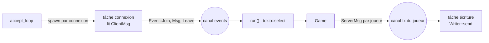
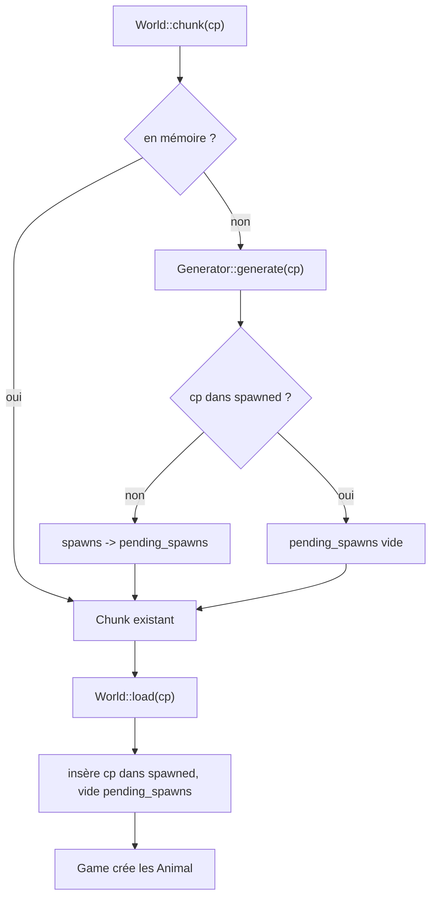

13
| Lignes | Section |
|---|---|
| 18-31 | Modules |
| 32-54 | Boucle de jeu |
| 55-67 | — Tick (20 Hz) |
| 68-75 | — Actions des joueurs |
| 76-90 | — Sessions et déconnexions |
| 91-117 | Monde par chunks |
| 118-124 | — Streaming de chunks |
| 125-139 | IA des animaux (paramétrique) |
| 140-162 | Sauvegarde |
| 163-167 | Docs liées |
# Serveur : architecture

> Vérifié le 2026-11-22 depuis `crates/server/src/` (`lib.rs`, `main.rs`, `net.rs`, `game.rs`, `ai.rs`, `save.rs`, `rng.rs`, `world/`). Fiche : [vue-ensemble.md](vue-ensemble.md).

## Modules

| Fichier | Rôle |
|---|---|
| `src/main.rs` | arguments `clap`, journalisation, `TcpListener`, signaux d'arrêt (ctrl-c, SIGTERM) |
| `src/lib.rs` | `run()` : boucle principale, chargement, autosauvegarde |
| `src/net.rs` | `accept_loop`, une tâche par connexion, pont vers `Game` par canaux |
| `src/game.rs` | `Game` : joueurs, animaux, actions, tick, envoi des messages |
| `src/ai.rs` | comportement des animaux, caresses et apprivoisement |
| `src/world/mod.rs` | `World` : chunks en mémoire, apparitions, persistance |
| `src/world/generator.rs`, `noise.rs` | génération procédurale (bruit de valeur fractal) |
| `src/save.rs` | `SaveData`, lecture et écriture de `world.bin` |
| `src/rng.rs` | PRNG et hachage déterministes (SplitMix64), sans dépendance externe |

## Boucle de jeu

Une seule tâche possède `Game` : pas de verrou, tout changement passe par `Game::event` ou `Game::tick`. Les tâches réseau n'y touchent que par canaux `mpsc` : `events` non borné (réseau vers jeu), file d'envoi par joueur bornée à `SEND_QUEUE` = 256 messages (jeu vers réseau).

`run()` (`crates/server/src/lib.rs`) attend dans un `tokio::select!` :

| Source | Action |
|---|---|
| `tick` (50 ms) | `game.tick()` ; `MissedTickBehavior::Skip` |
| canal `events` | `game.event()` |
| `autosave` (60 s) | `save()` |
| `shutdown` | sort de la boucle, sauvegarde finale |

### Tick (20 Hz)

`Game::tick` (`TICK` = 50 ms) enchaîne, dans cet ordre :

1. **Mouvements** : exécute le `pending_move` des joueurs dont `next_move` est échu.
2. **IA** : `ai::step`.
3. **Streaming de chunks** : `stream_chunks` pour chaque joueur.
4. **Entités** : `send_entities` envoie à chaque joueur les entités à moins de `VIEW_TILES` (96 tuiles). Le filtre par distance passe avant le clonage : seules les entités visibles sont copiées.

5. **File pleine** : un joueur dont la file d'envoi a débordé pendant le tick est déconnecté (`leave`), voir « Sessions et déconnexions ».

Un `Move` reçu hors cooldown (`MOVE_COOLDOWN` = 90 ms) s'exécute tout de suite dans `handle`. Sinon, il est mémorisé en `pending_move` (un seul, le dernier) pour le prochain tick.

### Actions des joueurs

Dans `Game::handle` : `Interact`, `Build`, `Break` visent la tuile adjacente dans la direction donnée. `Build` pose `Tile::BUILT` (`Wall`) sur une tuile praticable, libre de joueur et d'animal. `Break` utilise `breaks_into` de la définition de la tuile. `set_tile` notifie par `TileChanged` les joueurs qui détiennent le chunk, plus un effet `Dust`.

`Chat` : contrôles supprimés, `trim`, 240 caractères max (`MAX_CHAT`), message vide ignoré ; diffusé à tous en `Log(Chat)`.

Les animaux ne bloquent jamais un joueur (commentaire de `try_move`), mais un joueur bloque les animaux.

### Sessions et déconnexions

`Game.players` est indexé par `ConnId` (unique par connexion TCP). La tâche connexion (`crates/server/src/net.rs`) :

- ferme la session après `READ_TIMEOUT` = 15 s sans message du client (le client envoie un `Ping` toutes les 5 s) ; une coupure sans fermeture TCP (wifi, half-open) n'immobilise donc plus une session fantôme pendant ~15 min ;
- arrête la lecture quand la tâche d'écriture se termine (écriture en échec, ou `Game` qui lâche le `tx`), et abandonne l'écriture à la fin de la lecture ;
- envoie `Event::Leave(conn)` à la fin.

Côté `Game` :

- Envoi par `Player::send` (`try_send`). File pleine : drapeau `overflow`, déconnexion au tick suivant. File fermée : rien, le `Leave` de la tâche réseau arrive de lui-même.
- `join` avec un nom déjà connecté **remplace** la session : l'ancien joueur est retiré de `players` (son `tx` est lâché, ce qui ferme sa connexion), il reçoit `Rejected("replaced by new connection")` en dernier message, et la nouvelle connexion reprend `id`, position et orientation (journal système « <nom> reconnected. » au lieu de « joined the world. »). Pas de passage par `offline`. Les animaux apprivoisés sont liés au nom : rien à migrer.
- Le `Leave` tardif de l'ancienne `ConnId` ne trouve plus de joueur : sans effet, il n'écrase ni le nouveau joueur ni `offline`.
- Nom nettoyé par `clean_name` (contrôles filtrés, `trim`, 16 caractères) ; plus de suffixe numérique.

## Monde par chunks

`World` (`crates/server/src/world/mod.rs`) génère les chunks à la demande et les garde en mémoire (aucune éviction : aucun `remove` ni `retain` sur `chunks` dans le code).

- **Génération** (`generator.rs`) : déterministe pour une graine donnée. L'altitude vient de `fbm(seed, x, y, 160.0, 5)`, la température et l'humidité de deux autres champs de bruit ; `Biome::select(altitude, température, humidité)` choisit le biome parmi la table `BIOMES` (bande d'altitude, puis climat le plus proche). La tuile est tirée dans la palette pondérée du biome, par hachage de la position.
- **Apparitions** : à la génération, on tire les animaux selon `spawns` du biome central du chunk (moyenne par espèce, partie entière plus tirage de la partie fractionnaire). Ils attendent dans `pending_spawns`.
- **`load(cp)`** : renvoie les animaux une seule fois (première insertion dans `spawned`). Lire une tuile avant n'efface pas les animaux (test `reading_a_tile_does_not_lose_the_chunk_animals`).
- **`spawned`** : ensemble des chunks dont les animaux ont déjà été créés. Il survit aux redémarrages et évite les doublons : un chunk régénéré après redémarrage n'a plus de `pending_spawns`.
- **`modified`** : un chunk dont une tuile a changé (`set_tile`) est sauvegardé en entier ; les autres sont régénérés au chargement.
- **Point d'apparition** (`spawn_point`) : anneaux carrés autour de (0, 0), échantillonnés toutes les 8 tuiles, d'abord dans `Plains` ou `Meadow`, sinon n'importe quelle terre praticable. Calculé une fois (`OnceCell`).
- **Connexion** (`Game::join`, `crates/server/src/game.rs`) : la position de départ (sauvegardée si le joueur était hors ligne, sinon `spawn_point`) est lue dans le monde modifié. Si la tuile n'est plus praticable (mur posé entre-temps), `nearest_walkable` prend la tuile praticable la plus proche (anneaux carrés, rayon max 32). `build` ne protège donc que les joueurs en ligne.

### Streaming de chunks

`Game::stream_chunks(conn)` : pour chaque chunk dans le rayon `VIEW_CHUNKS` (3, `crates/shared/src/protocol.rs`) autour du joueur non présent dans `Player.sent`, appelle `world.load`, crée les animaux fraîchement apparus (`next_id`), envoie `ServerMsg::Chunk` et l'ajoute à `sent`. Les chunks à plus de `KEEP_CHUNKS` (= `VIEW_CHUNKS + 1`, partagé avec le client) sont retirés de `sent` ; le client les oublie à la même distance, ils seront renvoyés au retour.

> [!NOTE]
> Les animaux ne disparaissent jamais d'eux-mêmes. Ils sont simplement gelés quand aucun joueur n'est à moins de `ACTIVE_RADIUS` (= `VIEW_TILES`, soit environ 2 fois la largeur et 6 fois la hauteur affichées par un terminal 120×40) tuiles.

## IA des animaux (paramétrique)

`crates/server/src/ai.rs` : une routine unique, pilotée par la struct `Ai` de chaque espèce (`crates/shared/src/content/species.rs`). Ajouter un animal n'ajoute pas de code : voir [guide-ajout-contenu.md](../guide-ajout-contenu.md).

| Champ `Ai` | Effet |
|---|---|
| `step_ms` | délai entre deux pas (jitter de plus ou moins 25 %) |
| `idle` | probabilité de rester immobile |
| `flee_radius` | fuit les joueurs plus proches que cette distance (0 = ne fuit jamais, même avec un joueur sur sa tuile) |
| `curious_radius` | s'approche des joueurs plus proches, une fois sur deux (arrêt à `FOLLOW_DIST` = 2 ; 0 = indifférent) |
| `tameable` | une caresse le fait suivre le joueur ; une seconde le libère |
| `sound_chance` | probabilité par pas d'émettre un son |

Priorité de décision dans `act` : animal apprivoisé trop loin (plus de `TELEPORT_DIST` = 40) se téléporte à côté de son maître ; apprivoisé au-delà de `FOLLOW_DIST` suit son maître (délai entre pas divisé par deux, plafonné à 200 ms) ; apprivoisé proche flâne (idle 0,85) ; sinon fuite, curiosité, puis errance. Un pas bloqué tente un déplacement latéral, jamais le demi-tour. Les sons passent dans le journal des joueurs à moins de `HEAR_RADIUS` (10) tuiles, avec un effet `Sound`.

## Sauvegarde

`crates/server/src/save.rs` : un seul fichier postcard, `<world>/world.bin`, écrit via `world.bin.tmp` (fsync) puis `rename` (atomique) et fsync du dossier : une coupure de courant laisse l'ancien ou le nouveau fichier, jamais un fichier tronqué.

| Champ de `SaveData` | Contenu |
|---|---|
| `version` | `SAVE_VERSION` (1) ; lue seule en tête de fichier ; version inconnue (ex. future) : erreur « unsupported save version N » |
| `seed`, `next_id` | graine du monde, prochain identifiant d'entité |
| `players` | `(nom, position, direction)` des joueurs connectés et hors ligne ; à la reconnexion sous le même nom, le joueur reprend sa position (`Game.offline`) |
| `chunks` | chunks modifiés uniquement |
| `spawned` | chunks dont les animaux ont été créés |
| `animals` | `(espèce, position, maître)` ; de nouveaux identifiants sont attribués au chargement |

Déclencheurs (`crates/server/src/lib.rs`) : toutes les 60 s (`AUTOSAVE`), et à l'arrêt sur ctrl-c ou SIGTERM (`shutdown_signal` dans `main.rs`). Une erreur d'écriture est journalisée sans arrêter le serveur. Au démarrage : sauvegarde existante (graine ignorée) sinon nouveau monde avec `--seed` ou une graine tirée de l'horloge.

Chargement : `save::decode` lit d'abord `version` seule (`postcard::take_from_bytes::<u32>`, premier champ de `SaveData`, varint), puis dispatche par `match`. Aujourd'hui un seul bras (`SAVE_VERSION` => décode `SaveData`) : pas de copie figée tant qu'une seule version existe.

> [!WARNING]
> Un changement incompatible du format doit ajouter une version (`version` doit rester le premier champ) :
> 1. copier la struct `SaveData` actuelle, figée, dans un module `save::v<N>` (N = ancienne version) ;
> 2. incrémenter `SAVE_VERSION` puis modifier `SaveData` ;
> 3. ajouter dans `decode` le bras `N =>` : décoder `v<N>::SaveData` puis convertir vers `SaveData`.

## Docs liées

- [carto-protocole.md](../carto-protocole.md)
- [guide-ajout-contenu.md](../guide-ajout-contenu.md)
- [client/carto-architecture.md](../client/carto-architecture.md)
