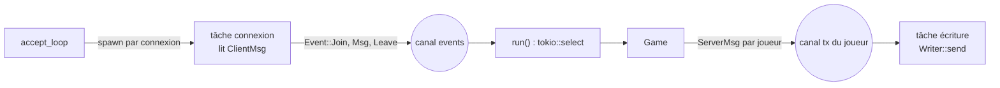
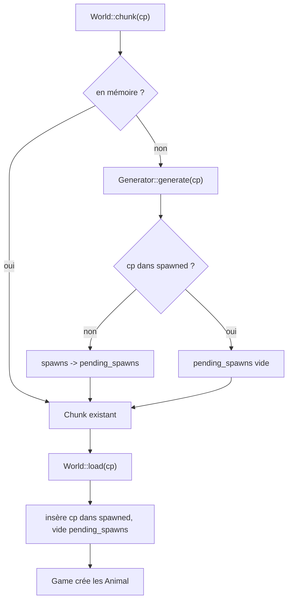

12
| Lignes | Section |
|---|---|
| 17-30 | Modules |
| 31-53 | Boucle de jeu |
| 54-64 | — Tick (20 Hz) |
| 65-70 | — Actions des joueurs |
| 71-96 | Monde par chunks |
| 97-103 | — Streaming de chunks |
| 104-118 | IA des animaux (paramétrique) |
| 119-136 | Sauvegarde |
| 137-141 | Docs liées |
# Serveur : architecture

> Vérifié le 2026-11-20 depuis `crates/server/src/` (`lib.rs`, `main.rs`, `net.rs`, `game.rs`, `ai.rs`, `save.rs`, `rng.rs`, `world/`). Fiche : [vue-ensemble.md](vue-ensemble.md).

## Modules

| Fichier | Rôle |
|---|---|
| `src/main.rs` | arguments `clap`, journalisation, `TcpListener`, signaux d'arrêt (ctrl-c, SIGTERM) |
| `src/lib.rs` | `run()` : boucle principale, chargement, autosauvegarde |
| `src/net.rs` | `accept_loop`, une tâche par connexion, pont vers `Game` par canaux |
| `src/game.rs` | `Game` : joueurs, animaux, actions, tick, envoi des messages |
| `src/ai.rs` | comportement des animaux, caresses et apprivoisement |
| `src/world/mod.rs` | `World` : chunks en mémoire, apparitions, persistance |
| `src/world/generator.rs`, `noise.rs` | génération procédurale (bruit de valeur fractal) |
| `src/save.rs` | `SaveData`, lecture et écriture de `world.bin` |
| `src/rng.rs` | PRNG et hachage déterministes (SplitMix64), sans dépendance externe |

## Boucle de jeu

Une seule tâche possède `Game` : pas de verrou, tout changement passe par `Game::event` ou `Game::tick`. Les tâches réseau n'y touchent que par canaux `mpsc` non bornés.

`run()` (`crates/server/src/lib.rs`) attend dans un `tokio::select!` :

| Source | Action |
|---|---|
| `tick` (50 ms) | `game.tick()` ; `MissedTickBehavior::Skip` |
| canal `events` | `game.event()` |
| `autosave` (60 s) | `save()` |
| `shutdown` | sort de la boucle, sauvegarde finale |

### Tick (20 Hz)

`Game::tick` (`TICK` = 50 ms) enchaîne, dans cet ordre :

1. **Mouvements** : exécute le `pending_move` des joueurs dont `next_move` est échu.
2. **IA** : `ai::step`.
3. **Streaming de chunks** : `stream_chunks` pour chaque joueur.
4. **Entités** : `send_entities` envoie à chaque joueur les entités à moins de `VIEW_TILES` (96 tuiles). Le filtre par distance passe avant le clonage : seules les entités visibles sont copiées.

Un `Move` reçu hors cooldown (`MOVE_COOLDOWN` = 90 ms) s'exécute tout de suite dans `handle`. Sinon, il est mémorisé en `pending_move` (un seul, le dernier) pour le prochain tick.

### Actions des joueurs

Dans `Game::handle` : `Interact`, `Build`, `Break` visent la tuile adjacente dans la direction donnée. `Build` pose `Tile::BUILT` (`Wall`) sur une tuile praticable, libre de joueur et d'animal. `Break` utilise `breaks_into` de la définition de la tuile. `set_tile` notifie par `TileChanged` les joueurs qui détiennent le chunk, plus un effet `Dust`.

Les animaux ne bloquent jamais un joueur (commentaire de `try_move`), mais un joueur bloque les animaux.

## Monde par chunks

`World` (`crates/server/src/world/mod.rs`) génère les chunks à la demande et les garde en mémoire (aucune éviction : aucun `remove` ni `retain` sur `chunks` dans le code).

- **Génération** (`generator.rs`) : déterministe pour une graine donnée. L'altitude vient de `fbm(seed, x, y, 160.0, 5)`, la température et l'humidité de deux autres champs de bruit ; `Biome::select(altitude, température, humidité)` choisit le biome parmi la table `BIOMES` (bande d'altitude, puis climat le plus proche). La tuile est tirée dans la palette pondérée du biome, par hachage de la position.
- **Apparitions** : à la génération, on tire les animaux selon `spawns` du biome central du chunk (moyenne par espèce, partie entière plus tirage de la partie fractionnaire). Ils attendent dans `pending_spawns`.
- **`load(cp)`** : renvoie les animaux une seule fois (première insertion dans `spawned`). Lire une tuile avant n'efface pas les animaux (test `reading_a_tile_does_not_lose_the_chunk_animals`).
- **`spawned`** : ensemble des chunks dont les animaux ont déjà été créés. Il survit aux redémarrages et évite les doublons : un chunk régénéré après redémarrage n'a plus de `pending_spawns`.
- **`modified`** : un chunk dont une tuile a changé (`set_tile`) est sauvegardé en entier ; les autres sont régénérés au chargement.
- **Point d'apparition** (`spawn_point`) : anneaux carrés autour de (0, 0), échantillonnés toutes les 8 tuiles, d'abord dans `Plains` ou `Meadow`, sinon n'importe quelle terre praticable. Calculé une fois (`OnceCell`).

### Streaming de chunks

`Game::stream_chunks(conn)` : pour chaque chunk dans le rayon `VIEW_CHUNKS` (3, `crates/shared/src/protocol.rs`) autour du joueur non présent dans `Player.sent`, appelle `world.load`, crée les animaux fraîchement apparus (`next_id`), envoie `ServerMsg::Chunk` et l'ajoute à `sent`. Les chunks à plus de `KEEP_CHUNKS` (= `VIEW_CHUNKS + 1`, partagé avec le client) sont retirés de `sent` ; le client les oublie à la même distance, ils seront renvoyés au retour.

> [!NOTE]
> Les animaux ne disparaissent jamais d'eux-mêmes. Ils sont simplement gelés quand aucun joueur n'est à moins de `ACTIVE_RADIUS` (= `VIEW_TILES`, soit 2 à 5 fois la zone affichée par un terminal 120×40) tuiles.

## IA des animaux (paramétrique)

`crates/server/src/ai.rs` : une routine unique, pilotée par la struct `Ai` de chaque espèce (`crates/shared/src/content/species.rs`). Ajouter un animal n'ajoute pas de code : voir [guide-ajout-contenu.md](../guide-ajout-contenu.md).

| Champ `Ai` | Effet |
|---|---|
| `step_ms` | délai entre deux pas (jitter de plus ou moins 25 %) |
| `idle` | probabilité de rester immobile |
| `flee_radius` | fuit les joueurs plus proches que cette distance |
| `curious_radius` | s'approche des joueurs plus proches (arrêt à `FOLLOW_DIST` = 2) |
| `tameable` | une caresse le fait suivre le joueur ; une seconde le libère |
| `sound_chance` | probabilité par pas d'émettre un son |

Priorité de décision dans `act` : animal apprivoisé trop loin (plus de `TELEPORT_DIST` = 40) se téléporte à côté de son maître ; apprivoisé au-delà de `FOLLOW_DIST` suit son maître (délai entre pas divisé par deux, plafonné à 200 ms) ; apprivoisé proche flâne (idle 0,85) ; sinon fuite, curiosité, puis errance. Un pas bloqué tente un déplacement latéral, jamais le demi-tour. Les sons passent dans le journal des joueurs à moins de `HEAR_RADIUS` (10) tuiles, avec un effet `Sound`.

## Sauvegarde

`crates/server/src/save.rs` : un seul fichier postcard, `<world>/world.bin`, écrit via `world.bin.tmp` puis `rename` (atomique).

| Champ de `SaveData` | Contenu |
|---|---|
| `version` | `SAVE_VERSION` (1) ; une version différente fait échouer le chargement (`read` renvoie une erreur, aucune conversion n'existe encore) |
| `seed`, `next_id` | graine du monde, prochain identifiant d'entité |
| `players` | `(nom, position, direction)` des joueurs connectés et hors ligne ; à la reconnexion sous le même nom, le joueur reprend sa position (`Game.offline`) |
| `chunks` | chunks modifiés uniquement |
| `spawned` | chunks dont les animaux ont été créés |
| `animals` | `(espèce, position, maître)` ; de nouveaux identifiants sont attribués au chargement |

Déclencheurs (`crates/server/src/lib.rs`) : toutes les 60 s (`AUTOSAVE`), et à l'arrêt sur ctrl-c ou SIGTERM (`shutdown_signal` dans `main.rs`). Une erreur d'écriture est journalisée sans arrêter le serveur. Au démarrage : sauvegarde existante (graine ignorée) sinon nouveau monde avec `--seed` ou une graine tirée de l'horloge.

> [!WARNING]
> `docs/CLAUDE.md` décrit un champ `version` dans `world/meta`. Le code utilise `world.bin` avec `version` dans `SaveData`. Un changement incompatible doit incrémenter `SAVE_VERSION` et ajouter la conversion dans `save::read`.

## Docs liées

- [carto-protocole.md](../carto-protocole.md)
- [guide-ajout-contenu.md](../guide-ajout-contenu.md)
- [client/carto-architecture.md](../client/carto-architecture.md)
