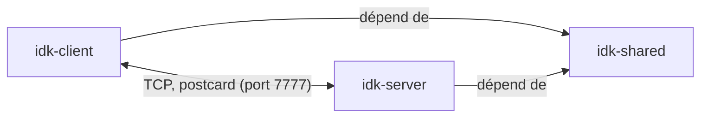

# console-rust-game-idk

> Dépôt `console-rust-game-idk`, chemin `./`. Vérifié le 2026-11-26 depuis `Cargo.toml`, `crates/*/Cargo.toml`, `Dockerfile`, `docker-compose.yml`, `.github/` et le code des trois crates.

Jeu multijoueur temps réel dans le terminal : serveur faisant autorité, client TUI. Workspace cargo (edition 2024), `resolver = "2"`, membres `crates/*`.

## Projets

| Projet | Dossier | Rôle | Fiche |
|---|---|---|---|
| `idk-shared` | `crates/shared` | lib : géométrie, tables de contenu, protocole, framing TCP | [shared](shared/vue-ensemble.md) |
| `idk-server` | `crates/server` | binaire + lib : boucle de jeu, monde procédural, IA, sauvegarde | [server](server/vue-ensemble.md) |
| `idk-client` | `crates/client` | binaire : TUI ratatui, assistant de config, reconnexion | [client](client/vue-ensemble.md) |

Les deux binaires ne se référencent pas : tout passe par le protocole de `idk-shared`, décrit dans [carto-protocole.md](carto-protocole.md).

## Docs transverses

- [carto-protocole.md](carto-protocole.md) : framing, messages, séquence de connexion, versionnement.
- [guide-ajout-contenu.md](guide-ajout-contenu.md) : ajouter tuiles, biomes, animaux, effets, objets.
- [server/carto-architecture.md](server/carto-architecture.md), [client/carto-architecture.md](client/carto-architecture.md).

## Dossiers sans code Rust

- `Dockerfile`, `docker-compose.yml`, `.dockerignore` : image multi-étapes (builder `rust:1-slim-bookworm`, `cargo build --release --locked`, puis cibles `server` et `client` sur `debian:bookworm-slim`, utilisateur non-root `idk`), cible `server` avec `HEALTHCHECK` (bash `/dev/tcp` sur `127.0.0.1:${IDK_PORT:-7777}`, l'image a bash), service `server` (port 7777, volume `world` monté en `/data`), service `client` (profil `client`, attend `server` en `service_healthy`, volume `client-config` monté en `/config`, `/etc/localtime` monté en lecture seule pour l'heure locale).
- `.github/` : `workflows/ci.yml` (job `check` : fmt, clippy `-D warnings`, tests, cargo en `--locked` ; job `docker` : build des cibles `server` et `client`, puis `--help` et `--version` de chaque image), `workflows/labels.yml` (workflow `Labels` : synchronise les labels depuis `labels.yml` au push sur `main` ou à la main, création et mise à jour, jamais de suppression), `labels.yml` (source de vérité des labels, protocole dans [guide-workflow-ia.md](guide-workflow-ia.md)), gabarits d'issue (`ISSUE_TEMPLATE/task.md`) et de PR (`pull_request_template.md`).
- `.claude/` : `settings.json` (permission `docs/mdx`, hook PostToolUse `hooks/reindex-md.sh` qui réindexe un `.md` de docs après Edit/Write), `skills/` (skills superpowers et `visual-docs` embarqués).
- `docs/` : cette documentation, règles dans [../../conventions-docs.md](../../conventions-docs.md).
